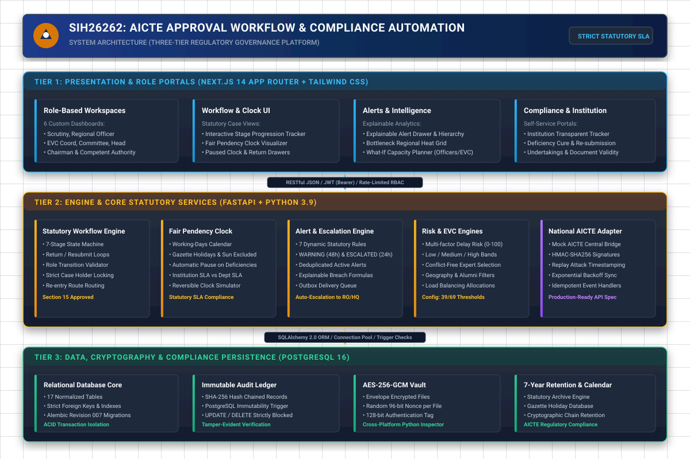
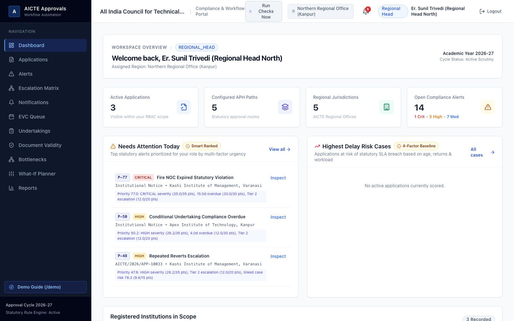
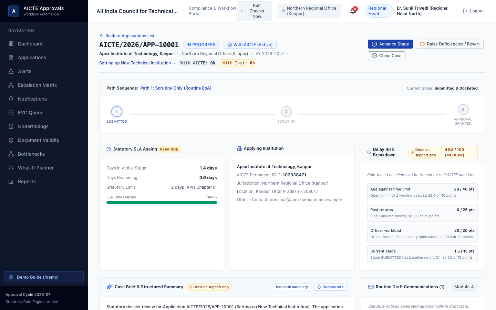
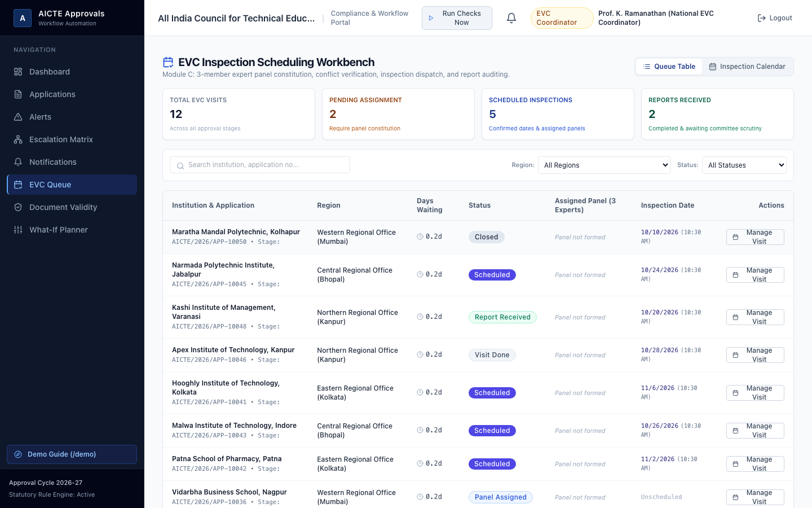
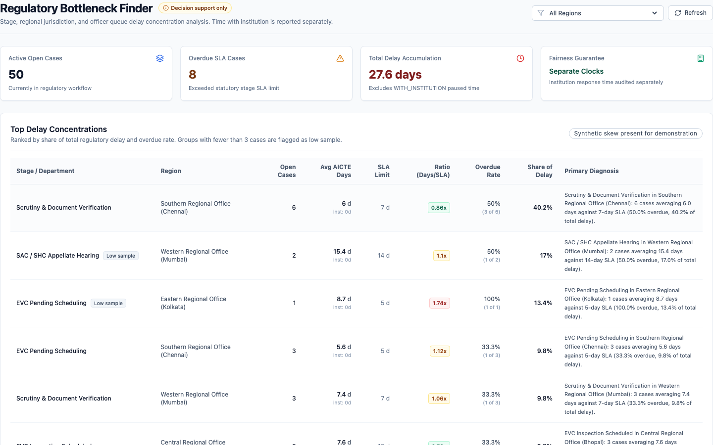

# SIH26262: Integrated AICTE Approval Workflow Automation, Compliance Monitoring and Alert Management System

> **A secure, intelligent, and transparent regulatory governance platform for the All India Council for Technical Education (AICTE)**. Built for the Smart India Hackathon.

[](https://github.com/subramanyam-11/SIH-New-PS)
[-blue?style=for-the-badge)](docs/16_test_report.md)
[](backend/scripts/scan_secrets.py)
[](backend/scripts/check_consistency.py)

---

## 30-Second Elevator Pitch for Hackathon Judges

Statutory regulatory approvals across AICTE's Approval Process Handbook (APH 2026) have historically suffered from opaque tracking, manual file delays, uncoordinated field inspections, and subjective compliance reviews.

**SIH26262 transforms this process into a predictable, auditable, and automated digital governance platform:**
1. **Fair Pendency Clock**: Implements statutory working-days SLA calculation (excluding state gazette holidays and Sundays) that automatically pauses when deficiencies are returned to institutions—eliminating false institutional penalties while holding officers accountable to strict statutory timelines.
2. **Explainable Real-Time Alert Engine**: Replaces black-box warnings with mathematical, plain-English justifications, actual observed metrics, and exact statutory APH clause citations across a 2-tier escalation hierarchy (WARNING at 48h, ESCALATED at 24h).
3. **Multi-Factor Delay Risk Scoring**: Quantifies delay probability (0–100) across historical revert frequency, document expiry proximity, pendency velocity, and regional load, categorized into centralized Low, Medium, and High bands.
4. **Conflict-Free EVC Panel Selection**: Recommends unbiased 3-member Expert Visit Committees filtered by geographic proximity, subject expertise, and strict alumni/conflict-of-interest checks.
5. **Cryptographic Immutability & National Sync**: Protects all procedural decisions in an append-only SHA-256 hash-chained ledger fortified with PostgreSQL triggers preventing row modification, envelope file encryption (AES-256-GCM), and HMAC-SHA256 mock integration with AICTE National Central databases.

---

## System Architecture



Full architectural specification available at [`docs/15_architecture.md`](docs/15_architecture.md).

---

## Problem Statement Feature Traceability Matrix (Modules A – F)

| Module | Core Functionality | Primary Screens | Backend Engine / APIs | Test Coverage |
| :--- | :--- | :--- | :--- | :--- |
| **Module A** | Core Statutory Workflow & 7-Stage State Machine | `/applications`, `/applications/[id]` | `WorkflowEngine`, `/api/v1/applications` | `test_workflow_engine.py` (7 tests) |
| **Module B** | Real-Time Delay Detection & Fair Pendency Clock | `/`, `/applications/[id]`, `/reports` | `WorkingDayService`, `ClockService` | `test_phase6_v2.py` (6 tests) |
| **Module C** | Explainable Alerts & 2-Tier Automated Escalations | `/alerts`, `/escalation-matrix` | `AlertEngine`, `/api/v1/alerts` | `test_alert_watchers.py` (9 tests) |
| **Module D** | Predictive Delay Risk Scoring & Bottleneck Heat Grid | `/bottlenecks`, `/planner` | `RiskScoreService`, `/api/v1/risk` | `test_phase7_innovation.py` (17 tests) |
| **Module E** | Institution Portal, Deficiencies & Undertakings | `/portal`, `/undertakings`, `/document-validity` | `UndertakingService`, `DocumentService` | `test_phase5_screens.py` (12 tests) |
| **Module F** | Cryptographic Ledger, File Encryption & Mock National AICTE | `/admin/audit`, `/admin/retention`, `/integration` | `AuditService`, `FileStorageService`, `AicteAdapter` | `test_phase8_security.py` (19 tests) |

Detailed feature mapping available in [`docs/22_feature_map.md`](docs/22_feature_map.md).

---

## Showcase Screenshots

| Regional Head Dashboard & Alerts | Statutory Case Detail & Fair Pendency Clock |
| :---: | :---: |
|  |  |
| **EVC Inspection Panel Selection** | **Regional Bottleneck Heat Grid** |
|  |  |

All 16 high-resolution screenshots (1440x900) are cataloged under [`docs/screenshots/`](docs/screenshots/).

---

## Quick Start & Verification (Cross-Platform)

### Option A: macOS & Linux (Make)

```bash
# 1. Setup Python virtual environment and Frontend dependencies
make setup

# 2. Reset database and seed foundation + 60 demo applications (takes ~4s)
make demo-reset

# 3. Run the comprehensive release check (Pytest, Secrets, Consistency, Audit Chain, Build)
make final-check

# 4. Start Development Servers (Backend on :8000, Frontend on :3001)
make dev
```

### Option B: Windows (PowerShell)

```powershell
# 1. Setup Backend & Database
cd backend
python -m venv .venv
.\.venv\Scripts\Activate.ps1
pip install -r requirements.txt
python scripts\demo_reset.py

# 2. Run Comprehensive Verification
Push-Location ..
.\scripts\powershell\final-check.ps1

# 3. Start Frontend
cd frontend
npm install
npm run dev
```

Visit the application at: **`http://localhost:3001`**  
Interactive Presenter Walkthrough Guide: **`http://localhost:3001/demo`**

---

## One-Click Demo Personas (`DEMO_MODE=true`)

When visiting `http://localhost:3001/login`, clicking any persona badge instantly logs in without typing:

| Persona Role | Demo Name | Demo Email | Access Scope & Visible Views |
| :--- | :--- | :--- | :--- |
| **Regional Head (North)** | Er. Sunil Trivedi | `ro.north@demo.example` | Scoped to Northern RO (UP, UK). Views Dashboard, Applications, EVC Queue, Undertakings, Documents, Reports. |
| **Scrutiny Officer** | Amit Sharma | `scrutiny1@demo.example` | Northern RO Desk. Assigned cases, deficiency returns, document audit, undertakings review. |
| **EVC Coordinator** | Prof. K. Ramanathan | `evc.coord@demo.example` | Southern RO Desk. EVC Inspection Queue, expert panel selection, conflict-free recommendations. |
| **Competent Authority** | Dr. Anand V. Joshi | `chairman@demo.example` | National Headquarters. SAC/SHC review, Executive bottlenecks, final statutory approvals & LOA orders. |
| **Bureau Officer** | Smt. Neha Mukherjee | `bureau.officer@demo.example` | Central Technical Bureau. Cross-region read-only oversight of pendency, bottlenecks, alerts. |
| **Committee Member (EVC)**| Dr. Anand Swaminathan | `evc.member@demo.example` | Expert Inspection Panel. Scoped strictly to assigned committee cases; non-binding advisory inputs. |
| **System Admin** | Dr. Rajesh Verma | `admin@demo.example` | Central HQ. Complete administrative control, APH rules config, holiday calendar, cryptographic audit. |
| **Institution User** | Dr. V. K. Saxena | `principal@apexkanpur.demo.example` | Apex Institute of Technology, Kanpur. Scoped strictly to own portal (`/portal`), deficiency replies. |

*Default Password for standard login*: **`Password@123`**

---

## What is Real vs. Mock (Honesty & Compliance Note)

In compliance with hackathon guidelines and regulatory integrity principles:

1. **Production-Ready & Fully Real**:
   - PostgreSQL 16 database schema with 17 normalized relational tables and foreign keys.
   - 7-stage statutory workflow engine with state transition validation and role enforcement.
   - Fair Pendency Clock calculating actual working days excluding Gazette holidays and Sundays.
   - Append-only cryptographic audit trail with SHA-256 hash chaining and PostgreSQL triggers blocking SQL UPDATE and DELETE operations.
   - AES-256-GCM authenticated envelope file encryption with random 96-bit nonces.
   - 96 passing unit, integration, and security tests.

2. **Simulated / Mocked for Demo Stability**:
   - **Institutions, Applications & Users**: All 15 institutions (e.g. Apex Institute of Technology), 60 applications (APP-10001 to APP-10060), and 21 user personas are 100% synthetic data generated for simulation. No real institutional or personal data is included.
   - **National AICTE Adapter (`/integration`)**: Communicates with a mock central AICTE adapter utilizing production-grade HMAC-SHA256 signatures, replay attack timestamp verification, and exponential backoff.
   - **Antivirus Scanner**: Uses a simulated ClamAV scanner that validates file headers, magic bytes, and detects standard EICAR test strings.
   - **Email Outbox (`/admin/outbox`)**: Emails are generated, formatted with templates, and safely stored in the database outbox (`EMAIL_SEND_ENABLED=false`) for visual auditing without sending spam.
   - **Statutory Citations**: All APH clauses are labeled with `(sample reference)` to clearly indicate pedagogical reference to the AICTE Approval Process Handbook.

Detailed disclosure available in [`docs/23_known_limitations.md`](docs/23_known_limitations.md).

---

## 3. Database Architecture & One-Command Reset

- **PostgreSQL 15**: Runs via Docker Compose or native Homebrew/service on port `5432`.
- **Cloud Switch**: Swap `DATABASE_URL` in `.env` to connect directly to Neon, Supabase, or AWS RDS without code alterations.
- **One-Command Reset**:
  ```bash
  # Drops all tables/enums, executes db/schema.sql, stamps Alembic version, and seeds foundation data:
  python backend/scripts/reset_db.py
  ```

---

## 4. Architectural Documentation Index

All planning specifications and Phase 2 reports are available under [`docs/`](file:///Users/subramanyam/Sih%20new/docs) and [`db/`](file:///Users/subramanyam/Sih%20new/db):

1. **[01. Scope and Assumptions](file:///Users/subramanyam/Sih%20new/docs/01_scope_and_assumptions.md)** - Scope matrix, decisions, and assumptions.
2. **[02. Stage Paths and Workflow Rules](file:///Users/subramanyam/Sih%20new/docs/02_stage_paths_and_rules.md)** - 5 APH workflow pathways, state machine diagram, and configurable SLA rules.
3. **[03. Roles and Permissions Matrix](file:///Users/subramanyam/Sih%20new/docs/03_roles_and_permissions.md)** - 6-role RBAC security matrix and visibility views.
4. **[04. Data Model & Architecture](file:///Users/subramanyam/Sih%20new/docs/04_data_model.md)** - Database design with Mermaid ER diagram and indexing strategy.
5. **[Database Schema (PostgreSQL)](file:///Users/subramanyam/Sih%20new/db/schema.sql)** - Executable PostgreSQL DDL with 22 tables.
6. **[Synthetic Seed Data Plan](file:///Users/subramanyam/Sih%20new/db/seed_plan.md)** - Seed plan for 15 institutions, 5 regions, and 60 applications.
7. **[05. Alert and Escalation Engine](file:///Users/subramanyam/Sih%20new/docs/05_alert_and_escalation_design.md)** - 3-tier escalation ladder, trigger conditions, and explainability schema.
8. **[06. API & Screen Blueprint](file:///Users/subramanyam/Sih%20new/docs/06_api_and_screens.md)** - REST API catalog and screen wireframe purposes.
9. **[07. Innovation Layer Plan](file:///Users/subramanyam/Sih%20new/docs/07_innovation_plan.md)** - Delay Risk Score, Explainable Alerts, AI Case Docket, and EVC Tour Optimizer.
10. **[08. Team Split & Execution Plan](file:///Users/subramanyam/Sih%20new/docs/08_team_split_and_timeline.md)** - 5-member work allocation across Phases 2 to 7.
11. **[09. Phase 2 Foundation Report](file:///Users/subramanyam/Sih%20new/docs/09_phase2_foundation_report.md)** - Detailed summary of foundation build, tests, and endpoints.
12. **[10. Phase 3 Core Engine Report](file:///Users/subramanyam/Sih%20new/docs/10_phase3_core_engine_report.md)** - Detailed summary of state machine, 60-application dataset, SLA clock, and Letter of Approval generation.
13. **[11. Phase 4 Alerts & Watchers Report](file:///Users/subramanyam/Sih%20new/docs/11_phase4_alerts_report.md)** - Detailed report on alert rules engine, APScheduler, 3-tier escalation ladder, notifications, and outbox queue.
14. **[12. Phase 5 Compliance & Reports Report](file:///Users/subramanyam/Sih%20new/docs/12_phase5_screens_report.md)** - Interactive screens for EVC, Undertakings, Documents, and 5 statutory reports.
15. **[13. Phase 6 Build Plan v2 Alignment Report](file:///Users/subramanyam/Sih%20new/docs/13_phase6_v2_alignment_report.md)** - Fair Pendency Clock, Working-Day Calendar, CLOSED state, Overdue cases report, and new roles.
16. **[14. Phase 7 Innovation Layer Report](file:///Users/subramanyam/Sih%20new/docs/14_phase7_innovation_report.md)** - Delay Risk Score, Bottleneck Finder, AI Case Summary, What-If Planner, and Smart Alert Ranking.

---

## 5. Running Tests and Verification

```bash
# Run backend test suite (73 unit, integration, RBAC, workflow engine, alert watcher, Phase 6, and Phase 7 innovation tests)
make test
# Or: cd backend && .venv/bin/pytest -v

# Run automated end-to-end smoke test suite (28 comprehensive checks covering Phases 1 through 7)
make smoke
# Or: ./scripts/smoke_test.sh

# Re-seed demo dataset (60 applications, clock segments, committee assignments, holidays, alerts)
make seed-demo
```

---

## 6. Phase 4 Interactive Demo Walkthrough

### Scenario A: Real-Time Alert Engine & Explainable Drawer
1. Log in via one-click persona as **Regional Head (North)** (`ro.north@demo.example`) or **Admin** (`admin@demo.example`).
2. Navigate to **Alerts** (`/alerts`) via the left sidebar.
3. Observe the live summary cards (Critical: 5, High: 22, Medium: 34) loaded strictly from the database.
4. Click on any alert (e.g. `RULE_FIRE_NOC_EXPIRED` or `RULE_SCRUTINY_OVERDUE`).
5. Inspect the **"Why This Alert Fired"** explainability panel:
   - Plain-English explanation sentence
   - Actual observed value vs. statutory threshold
   - Regulatory APH clause with the visible `(sample reference)` marker
   - Escalation history timeline

### Scenario B: Procedural Officer Actions (Acknowledge, Snooze, Resolve)
1. On the open alert drawer, click **Acknowledge** and enter remarks. The status transitions to `ACKNOWLEDGED`.
2. Click **Snooze**, choose 24 Hours, and enter a substantive justification. The alert is snoozed. Note: attempting a third snooze triggers the strict database limit error (max 2).
3. Log in as **Competent Authority** (`chairman@demo.example`) or **Admin**. Open the alert drawer and click **Mark Resolved** with a written justification. The alert is statutorily resolved.

### Scenario C: Regional Escalation Hierarchy Matrix
1. Click **Escalation Matrix** (`/escalation-matrix`) in the navigation menu.
2. View the 5 regional offices against the 3-tier escalation ladder:
   - **Tier 1**: Scrutiny / Desk Officer (Assigned officer, delay 0d)
   - **Tier 2**: Regional Head (delay 2d)
   - **Tier 3**: Member Secretary / Competent Authority (delay 5d)
3. View open alert counts at each tier and click through to inspect filtered alerts.

### Scenario D: Dynamic Time-Travel Escalation & Outbox Queue
1. In the Top Bar, observe the **Notification Bell** with unread count badge. Click it to preview the latest alerts.
2. Click **Run Checks Now** in the top bar to evaluate rules on demand.
3. Advance the demo clock by **+24 Hours** or **+168 Hours (+7 Days)** on `/applications`.
4. Observe that the alert engine automatically evaluates the advanced clock: near-breach alerts upgrade to overdue, and unacknowledged alerts escalate from L1 to L2 and L3.
5. As Admin, navigate to **Email Outbox** (`/admin/outbox`). Inspect all queued notifications. Because `EMAIL_SEND_ENABLED=false` by default, all emails are safely held in `SUPPRESSED` status with full in-app previewability.

---

## 7. Email Outbox Configuration (`EMAIL_SEND_ENABLED`)

In `.env`:
```ini
# When false (default for hackathon demo): emails stay in database outbox as SUPPRESSED
# and are viewable in the app at /admin/outbox without sending actual SMTP traffic.
EMAIL_SEND_ENABLED=false

# When true: emails are dispatched through configured SMTP credentials
SMTP_HOST=smtp.gmail.com
SMTP_PORT=587
SMTP_USER=demo@demo.example
SMTP_PASSWORD=secret
```

---

14. **[12. Phase 5 Operational Screens Report](file:///Users/subramanyam/Sih%20new/docs/12_phase5_screens_report.md)** - Detailed report on EVC queue, Undertakings, Document validity, Executive reports, and Institution Portal.

---

## 5. Running Tests and Verification

```bash
# Run backend test suite (38 unit, RBAC, workflow engine, alert watchers, and Phase 5 screen tests)
make test

# Execute automated smoke test suite (17 end-to-end integration steps)
./scripts/smoke_test.sh

# Re-seed demo database with full lived-in dataset
make seed-demo
```

---

## 6. Role-Based Demo Walkthrough Script (Phase 5)

### Scenario A: Institution User (`principal@apexkanpur.demo.example`)
1. Login with one-click chip **Institution User (Apex Institute)**.
2. Note that your sidebar shows only **My Applications** (`/portal`), **Undertakings** (`/portal/undertakings`), and **Document Validity** (`/portal/documents`). Alerts and officer screens are completely hidden.
3. In `/portal`:
   - Inspect the statutory progress stepper on application `AICTE/2026/APP-10001`.
   - Review formal notices dispatched by AICTE in the *Notices & Letters* feed.
   - Click **Submit New Application** to file a new institutional submission.
4. In `/portal/undertakings`:
   - Inspect open conditions and due date countdowns.
   - Click **Upload Evidence Document** on an open undertaking, attach a PDF (`/tmp/sample.pdf`), add justification, and submit. Status transitions to `Submitted (Awaiting Officer Audit)`.
5. In `/portal/documents`:
   - Inspect statutory certificates (Lease, Fire NOC, FDR Guarantee).
   - Click **Upload Renewal**, specify a new expiry date, select a file, and submit. Notice status shows *"Renewal submitted, awaiting verification"*.

### Scenario B: Scrutiny Officer (`scrutiny1@demo.example`)
1. Login with one-click chip **Scrutiny Officer (Northern RO)**.
2. Navigate to **Undertakings** (`/undertakings`):
   - Locate the undertaking submitted by Apex Institute.
   - Click **Review & Audit** to open the slide-out drawer.
   - Download and inspect the uploaded evidence file.
   - Select **Verified** (or **Reject** / **Need Evidence**) with officer audit remarks and click **Submit Determination**. Notice the audit history timeline records the event.
3. Navigate to **Document Validity** (`/document-validity`):
   - Find documents in `Critical <=30d` or `Renewal submitted`.
   - Click **Review & Audit** to view the version history (`v1 -> v2`).
   - Approve or reject the renewal dossier. Notice linked alerts auto-resolve upon officer verification.

### Scenario C: EVC Coordinator (`evc.coord@demo.example`)
1. Login with one-click chip **EVC Coordinator**.
2. Navigate to **EVC Queue** (`/evc-queue`):
   - Filter by status `Pending Assignment` or toggle to **Inspection Calendar** view.
   - Notice institutions marked with the **NEW INSTITUTION** badge.
   - Click **Manage Visit** on a visit in `Pending Assignment`.
   - In Step 1, review the decision-support **Suggested Experts** ranked by suitability.
   - Observe conflict warnings displayed in plain English (e.g. *Home city matches institution location* or *Exceeds max concurrent visits*).
   - Select exactly 3 conflict-free experts and click **Confirm 3-Member Panel**.
   - In Step 2, pick the inspection date and assembly time and click **Confirm Inspection Date**. Notice linked unscheduled alerts auto-resolve.
   - In Step 3 & 4, mark visit completed and upload the signed EVC report.
   - In Step 5, click **Close EVC Visit**. The scrutiny officer can now advance the case to SAC/SHC.

### Scenario D: Regional Head (`ro.north@demo.example`)
1. Login with one-click chip **Regional Head (North)**.
2. Navigate to **Reports** (`/reports`):
   - Inspect **Pendency & Ageing** with Recharts bar chart showing pending vs overdue cases by stage.
   - Switch to **Regional Performance Matrix** to compare SLA breach rates across all regions.
   - Click **Export CSV** to download `aicte_regional_performance_report.csv`.
   - Click **Export PDF** to generate and download a formal `aicte_regional_performance_report.pdf` docket.
   - Switch to **Institution Health Dossier**, select any institution, and inspect its 360-degree regulatory compliance score and dossier.

### Scenario E: Competent Authority (`chairman@demo.example`)
1. Login with one-click chip **Competent Authority**.
2. Navigate to **Undertakings** (`/undertakings`):
   - View undertakings flagged with the **Escalated to Council** badge (&ge; 2 rejections or severe overdue delay).
   - Review the failure history and exercise council override authority.
3. Navigate to **Applications** (`/applications/1`):
   - Click **Record Statutory Decision**, select `APPROVE`, and record formal council justification.
   - Click **View Sample Order (LoA)** to inspect the generated Letter of Approval with visible `SAMPLE` watermark.

---

## 7. Email Outbox Configuration (`EMAIL_SEND_ENABLED`)

In `.env`:
```ini
# When false (default for hackathon demo): emails stay in database outbox as SUPPRESSED
# and are viewable in the app at /admin/outbox without sending actual SMTP traffic.
EMAIL_SEND_ENABLED=false

# When true: emails are dispatched through configured SMTP credentials
SMTP_HOST=smtp.gmail.com
SMTP_PORT=587
SMTP_USER=demo@demo.example
SMTP_PASSWORD=secret
```

---

## 8. Phase 7 Innovation Layer (Build Plan v2 Sections 9 & 10)

Phase 7 introduces explainable intelligent decision support for AICTE officers, regional directors, and council leadership. Every smart feature strictly adheres to Section 10 human oversight principles:
- Carries the persistent **"Decision support only"** badge.
- Provides transparent plain-language explanations for all calculations.
- **NEVER** moves, approves, rejects, reverts, or closes an application automatically.

### Key Innovation Features

1. **Explainable Delay Risk Score**:
   - Computes a transparent 0-100 score from 4 database-backed factors:
     - **Age against time limit** (40 pts): AICTE-held working days in current stage divided by SLA, capped at 150%. Paused institution time is strictly excluded.
     - **Past returns** (25 pts): `revert_count` divided by revert cap (default 2).
     - **Officer workload** (20 pts): Open active cases of assigned officer divided by capacity (default 12).
     - **Current stage baseline** (15 pts): Multiplier reflecting inherent logistical complexity (higher for EVC / SAC / SHC).
   - Classified into Low (<40), Medium (40-70), and High (>70) risk bands.
   - Fully inspectable breakdown card on `/applications/[id]` and Admin weights configuration tab on `/settings/rules`.

2. **Bottleneck Finder (`/bottlenecks`)**:
   - Aggregates by stage, region, and officer queue: open cases, average AICTE-held working days, overdue breach rate, and percentage share of total system delay.
   - Separates institutional response time so desk officers are never unfairly penalized.
   - Region-by-stage interactive heat grid and low-sample guards (<3 cases).

3. **Structured AI Case Summary (`/applications/[id]`)**:
   - Structured summary components: case snapshot, timeline highlights, pending items, upcoming deadlines, top delay risk drivers, and suggested next steps for the desk officer.
   - Offline deterministic template summary by default.
   - Optional provider switch in `.env` (Gemini API) to rewrite structured facts in natural prose.
   - SHA-256 payload caching in `case_summaries` table with manual "Regenerate Summary" action.
   - **Strict Privacy Rule**: Transmits only sanitized metadata (stage, dates, counts, deficiency tags, rule codes). Never transmits uploaded file contents or personal data.

4. **What-If Capacity Planner (`/planner`)**:
   - Read-only simulation modeling:
     - (a) Extra EVC visits completed per week (0 to 10)
     - (b) Extra staffing capacity units (0 to 5)
     - Horizon in weeks (1 to 8)
   - Computes counterfactual backlog depletion, queue wait day reductions, cases moving forward, and avoided overdue inspection alerts.
   - **Strict Invariance**: Never alters real database records.

5. **Smart Alert Ranking & Daily Digests (`/alerts`)**:
   - Multi-factor priority score (0-100) combining severity (35%), days overdue (30%), escalation tier (20%), and regulatory impact (15%).
   - Alerts list defaults to explainable priority order with a dedicated "why ranked here" rationale line.
   - "Needs Attention Today" top-10 card on the main dashboard (`/`).
   - Admin action to draft consolidated daily digests in the email outbox (`/admin/outbox`).

---

## 9. Optional LLM Provider Configuration

In `.env`:
```ini
# LLM Provider Configuration (Phase 7 Innovation)
# Default is 'none' (deterministic offline template summary)
LLM_PROVIDER=none
# To enable Gemini API summarization:
# LLM_PROVIDER=gemini
# LLM_API_KEY=your_gemini_api_key_here
# LLM_TIMEOUT_SECONDS=10
```

*Fallback Guarantee*: If `LLM_PROVIDER=none`, `LLM_API_KEY` is missing, or an external API call times out or fails, the system automatically falls back to the deterministic offline template summary without throwing errors. The user interface explicitly labels each summary as either *"Template summary"* or *"AI-assisted summary"*.

---

## 10. Phase 8 Security Hardening, Verification & Proof Commands

Phase 8 introduces enterprise-grade security hardening, cryptographic auditability, and national integration adapters:

### 10.1 Key Make Commands
```bash
# Verify the entire cryptographic SHA-256 audit log hash chain
make verify-audit

# Export current FastAPI OpenAPI specification schema
make openapi

# Execute all 90 automated regression tests and generate docs/16_test_report.md
make test-report
```

### 10.2 Security Hardening Architecture
1. **Cryptographic Append-Only Audit Trail (`/admin/audit`)**:
   - PostgreSQL trigger `trg_audit_log_prevent_modify` unconditionally blocks any SQL `UPDATE` or `DELETE` attempt.
   - Every row stores `prev_hash` and SHA-256 `hash`. Writes acquire transactional advisory lock `pg_advisory_xact_lock(987654321)` to eliminate chain forks.
   - Interactive verification button walks all records from genesis to confirm 100% cryptographic continuity.
   - Run `python backend/scripts/demo_tamper_check.py` to watch the verifier catch an altered record and roll back cleanly.

2. **AES-256-GCM File Encryption at Rest & Magic-Byte Validation**:
   - Uploaded documents are encrypted on disk with AES-256-GCM using keys configured via `FILE_ENCRYPTION_KEY`.
   - Each file maintains its own 96-bit initialization vector and key ID for zero-downtime key rotation.
   - Strict inspection: single extension enforcement, double-extension rejection (`.pdf.exe`), and magic byte validation (`%PDF`, `\x89PNG`, `\xff\xd8\xff`).
   - Anti-malware interface rejects standard EICAR test patterns (`DemoScanner`) and provides ClamAV daemon connectivity.

3. **Access Hardening & Login Lockout**:
   - In-memory failed attempt tracking triggers temporary account lockout for 15 minutes after 5 consecutive failures.
   - Mandatory security headers (`X-Content-Type-Options: nosniff`, `X-Frame-Options: DENY`, `Referrer-Policy: strict-origin-when-cross-origin`, `Content-Security-Policy`).
   - `DEMO_MODE=False` completely disables `/demo-login` and hides all demo persona chips.

4. **Mock AICTE System Adapter (`/integration`)**:
   - Standardized `AicteSystemAdapter` interface with `MockAicteAdapter` implementation for national portal synchronization.
   - Inbound webhook authentication via `X-API-Key` + `X-Timestamp` (rejecting replay requests with drift $>300$ seconds) + HMAC-SHA256 signature (`X-Signature`).
   - Idempotent request replay caching via `X-Idempotency-Key`.
   - Clearly labelled: *"MOCK ADAPTER. No real AICTE system is contacted"*.

5. **Statutory Data Retention Dry Run (`/admin/retention`)**:
   - Configurable statutory retention thresholds stored in `system_config`.
   - Non-destructive candidate preview and CSV compliance export.
   - Audit log is permanently exempt from archival or deletion.
   - Clearly labelled: *"Preview only. No data is deleted by this prototype."*

