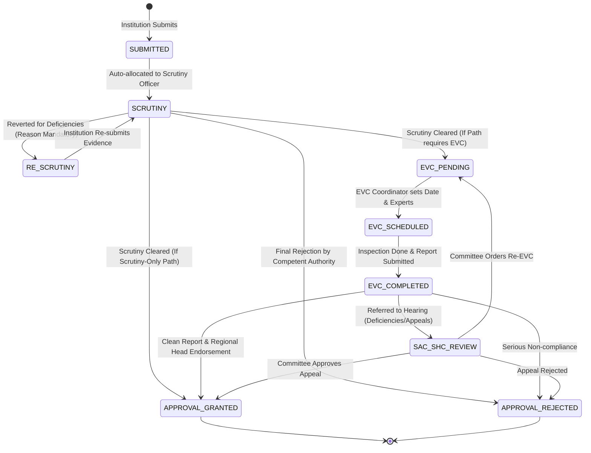

# 02. Stage Paths and Workflow Rules

## 1. Overview of Approval Pathways

Under the AICTE Approval Process Handbook (APH), an application is classified into a specific **Workflow Path** based on the application category. Each path defines the ordered sequence of statutory stages an application must traverse.

### Defined Workflow Paths

1. **Path 1: `PATH_1_SCRUTINY_ONLY` (Extension of Approval - Routine)**
   - *Application Categories*: Existing Institutions seeking Extension of Approval (EoA) without changes in intake or land/building alterations.
   - *Stage Sequence*: `SUBMITTED` -> `SCRUTINY` -> `APPROVAL_GRANTED` / `APPROVAL_REJECTED` (or `RE_SCRUTINY` upon deficiency response).
   
2. **Path 2: `PATH_2_SCRUTINY_EVC` (New Institution / Major Expansion)**
   - *Application Categories*: Setting up a new technical institution, conversion from women's to co-ed, change of site, or significant expansion.
   - *Stage Sequence*: `SUBMITTED` -> `SCRUTINY` -> `EVC_PENDING` -> `EVC_SCHEDULED` -> `EVC_COMPLETED` -> `APPROVAL_GRANTED` / `APPROVAL_REJECTED`.

3. **Path 3: `PATH_3_EVC_SAC_SHC` (Appellate / Hearing Cycle)**
   - *Application Categories*: Applications rejected in Scrutiny/EVC appealing before the Standing Hearing Committee (SHC) or Standing Appellate Committee (SAC).
   - *Stage Sequence*: `SUBMITTED` -> `SAC_SHC_REVIEW` -> `EVC_PENDING` -> `EVC_SCHEDULED` -> `EVC_COMPLETED` -> `APPROVAL_GRANTED` / `APPROVAL_REJECTED`.

4. **Path 4: `PATH_4_EVC_ONLY` (Physical Verification / Surprise Inspection)**
   - *Application Categories*: Complaints, random physical audit, or unannounced infrastructure verification of existing campuses.
   - *Stage Sequence*: `SUBMITTED` -> `EVC_PENDING` -> `EVC_SCHEDULED` -> `EVC_COMPLETED` -> `SAC_SHC_REVIEW` (if adverse findings) -> `APPROVAL_GRANTED` / `APPROVAL_REJECTED`.

5. **Path 5: `PATH_5_FULL_CYCLE` (Comprehensive Disputed / High-Risk Application)**
   - *Application Categories*: New University Constituent colleges or complex mergers with legal covenants.
   - *Stage Sequence*: `SUBMITTED` -> `SCRUTINY` -> `RE_SCRUTINY` -> `EVC_PENDING` -> `EVC_SCHEDULED` -> `EVC_COMPLETED` -> `SAC_SHC_REVIEW` -> `APPROVAL_GRANTED` / `APPROVAL_REJECTED`.

---

## 2. Stage State Machine & Transitions



---

## 3. Transition Rules and Permissions Matrix

| Current Stage | Target Stage | Trigger Action | Allowed Roles | Mandatory Preconditions & Reason Rules |
| :--- | :--- | :--- | :--- | :--- |
| `SUBMITTED` | `SCRUTINY` | Start Scrutiny | `SCRUTINY_OFFICER`, `REGIONAL_HEAD` | Verifies application fee and core dossier upload. |
| `SCRUTINY` | `RE_SCRUTINY` | Revert / Raise Deficiencies | `SCRUTINY_OFFICER`, `REGIONAL_HEAD` | **Mandatory deficiency code and textual reason required**. Revert email dispatched to institution. |
| `RE_SCRUTINY` | `SCRUTINY` | Submit Clarification | `INSTITUTION_USER` | All deficiency points marked as addressed with supporting document upload. |
| `SCRUTINY` | `EVC_PENDING` | Recommend EVC | `SCRUTINY_OFFICER`, `REGIONAL_HEAD` | All document checks pass; path includes EVC. |
| `SCRUTINY` | `APPROVAL_GRANTED` | Recommend Approval | `SCRUTINY_OFFICER` -> `REGIONAL_HEAD` | Valid only for `PATH_1_SCRUTINY_ONLY`. Requires Regional Head signoff. |
| `EVC_PENDING` | `EVC_SCHEDULED` | Schedule Inspection | `EVC_COORDINATOR`, `REGIONAL_HEAD` | Requires inspection date, team leader name, and 2-3 committee members assigned. |
| `EVC_SCHEDULED` | `EVC_COMPLETED` | Submit EVC Report | `EVC_COORDINATOR`, `REGIONAL_HEAD` | Inspection report PDF metadata, pass/fail status, and geo-tagged photos verified. |
| `EVC_COMPLETED` | `SAC_SHC_REVIEW` | Refer to Committee | `REGIONAL_HEAD`, `COMPETENT_AUTHORITY` | Triggered if critical infrastructure deficiencies found or upon institution request. |
| `EVC_COMPLETED` | `APPROVAL_GRANTED` | Final Approval | `REGIONAL_HEAD`, `COMPETENT_AUTHORITY` | Zero fatal defects; undertaking conditions (if any) accepted and recorded. |
| `SAC_SHC_REVIEW` | `APPROVAL_GRANTED` | Grant on Appeal | `COMPETENT_AUTHORITY` | Committee minutes of meeting (MoM) reference number mandatory. |
| `ANY_STAGE` | `APPROVAL_REJECTED`| Reject Application | `REGIONAL_HEAD`, `COMPETENT_AUTHORITY` | **Mandatory statutory rejection reason citing specific APH clause**. |

---

## 4. Revert / Return Policy

1. **Deficiency Protocol**:
   - An application can be reverted to `RE_SCRUTINY` when specific documentation or regulatory proof is missing.
   - The officer cannot trigger revert without selecting at least one **Deficiency Tag** (e.g., `DEF_LAND_TITLE`, `DEF_FIRE_NOC`, `DEF_FACULTY_CADRE`, `DEF_FDR_VALIDITY`) and typing a detailed finding.
2. **Maximum Cycles**:
   - By default, an application can undergo a maximum of **2 Re-Scrutiny cycles** to prevent indefinite administrative ping-pong. Exceeding this triggers an escalation alert to the `REGIONAL_HEAD`.
3. **Time Clock Freeze**:
   - When an application is in `RE_SCRUTINY`, the officer processing clock is paused, and the institution countdown timer (e.g., 7 days to reply) starts.

---

## 5. Configurable Rules Engine (APH-Driven)

Timelines and thresholds are never hardcoded. They are stored in database table `stage_paths` and `alert_rules` as JSON/tabular definitions.

### Default Timelines Configuration (Stored in DB)

```json
{
  "academic_year": "2026-2027",
  "version": "APH_2026_V1",
  "stage_sla_days": {
    "SCRUTINY": 7,
    "RE_SCRUTINY_INSTITUTION_LIMIT": 7,
    "EVC_PENDING_TO_SCHEDULE": 5,
    "EVC_SCHEDULED_TO_VISIT": 10,
    "EVC_VISIT_TO_REPORT": 3,
    "SAC_SHC_REVIEW": 14,
    "FINAL_APPROVAL_DECISION": 5
  },
  "alert_thresholds": {
    "near_breach_threshold_percent": 80,
    "near_breach_min_days_before": 2,
    "evc_unscheduled_warning_days": 3,
    "undertaking_warning_days": [60, 30, 15, 7],
    "document_expiry_warning_days": [90, 60, 30, 15, 7]
  },
  "escalation_ladder": {
    "tier_1_officer": 0,
    "tier_2_regional_head_days_overdue": 2,
    "tier_3_competent_authority_days_overdue": 5
  }
}
```

### Explanation of SLA Rules

1. **Scrutiny SLA (7 Days)**:
   - Scrutiny Officer must complete document evaluation within 7 calendar days of allocation.
   - At Day 5 (80% SLA), a `NEAR_BREACH` warning is generated.
   - At Day 8, an `OVERDUE` alert triggers and escalates to the Regional Head.
2. **EVC Scheduling SLA (5 Days)**:
   - Once recommended for EVC, the coordinator must assign dates and experts within 5 calendar days.
   - If not scheduled by Day 3, an `EVC_UNSCHEDULED` alert notifies the Regional Coordinator.
3. **EVC Report Submission (3 Days)**:
   - Following physical inspection, the committee report must be uploaded within 72 hours.
4. **Document & Lease Expiry (90-Day Horizon)**:
   - Automated nightly watcher scans leases, FDRs, and fire NOCs.
   - First reminder at 90 days prior to expiry; escalates progressively at 60, 30, and 7 days.
