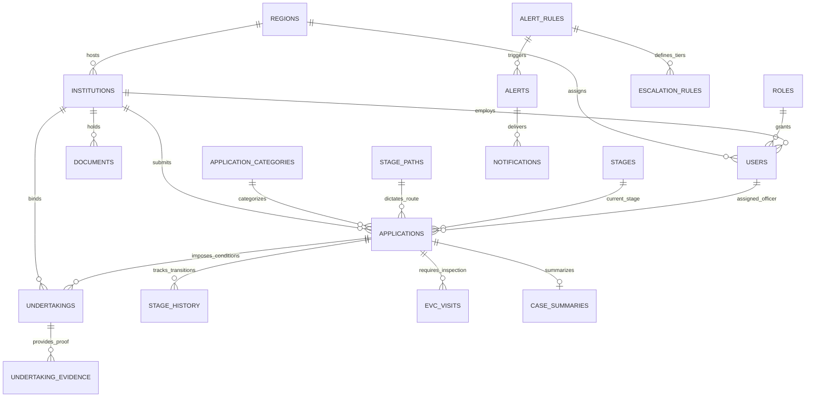

# 04. Data Model and Database Architecture

## 1. Entity Relationship Overview

The data model for SIH26262 is designed around an immutable state-transition log, configurable regulatory paths, and dedicated compliance tracking for conditional undertakings and expiring statutory documents.

---

## 2. Core Architectural Pillars

### A. Dynamic Workflow State Engine
- **`stage_paths` & `stages`**: Defines allowable paths (e.g. `PATH_1_SCRUTINY_ONLY`, `PATH_2_SCRUTINY_EVC`). Each stage specifies its default SLA (`default_sla_days`) and the responsible role.
- **`stage_history`**: Every movement (`ADVANCE`, `REVERT`, `RE_SUBMIT`, `REJECT`) creates an immutable record capturing:
  - `actor_id`: Who made the decision.
  - `reason`: Mandatory for any revert or rejection.
  - `deficiency_tags`: Standardized taxonomy of issues (e.g., `DEF_LAND_TITLE`, `DEF_FIRE_NOC`).
  - `duration_hours`: Exact time elapsed in stage for bottleneck analytics.

### B. EVC Inspection Tracking
- **`evc_visits`**: Decoupled from application core to allow full scheduling logistics:
  - Supports panel chair + experts stored as structured JSONB (`committee_experts`).
  - Tracks key statutory milestones: `PENDING_SCHEDULE`, `SCHEDULED`, `VISIT_COMPLETED`, and `REPORT_SUBMITTED`.
  - Captures geo-inspection report metadata and final recommendation (`RECOMMENDED`, `DEFICIENCIES_FOUND`, `REJECTED`).

### C. Compliance & Statutory Document Tracking
- **`documents`**: Specifically addresses lease expirations and recurring NOC renewals.
  - Tracks `document_type` (`LAND_LEASE_DEED`, `FIRE_SAFETY_NOC`, `AICTE_FDR_GUARANTEE`, etc.).
  - Has explicit `expiry_date` with indexed B-tree search for the automated nightly watcher.
  - Tracks renewal status (`ACTIVE`, `RENEWAL_SUBMITTED`, `EXPIRING_SOON`, `EXPIRED`).
- **`undertakings` & `undertaking_evidence`**:
  - Encapsulates conditions imposed during provisional approval.
  - Institutions submit evidence files (`undertaking_evidence`) reviewed by designated verification officers.

### D. Explainable Alert & Escalation System
- **`alert_rules`**: Stores rule code, condition logic in JSONB, severity, `day_basis` (`WORKING` or `CALENDAR`), and the specific **APH reference clause**.
- **`alerts`**: When an alert fires, it saves `explanation_meta` capturing rule code, days remaining/overdue, whether working or calendar days were evaluated, and statutory non-working day notes if deadlines hit weekends/holidays.
- **`escalation_rules`**: Defines multi-tiered ladders (Tier 1: Scrutiny Officer, Tier 2: Regional Head, Tier 3: Competent Authority) based on days overdue.

### E. Phase 6 (v2 Alignment) Additions
- **`clock_segments`**: Immutable time-tracking segments for fair pendency accounting:
  - `holder`: `WITH_AICTE` vs `WITH_INSTITUTION`.
  - `started_at`, `ended_at`, `duration_hours`, `reason`.
  - Elapsed time for AICTE SLA, ageing buckets, and alerts counts ONLY `WITH_AICTE` segments.
- **`holidays`**: Statutory calendar definitions:
  - `date`, `name`, `region_id` (nullable for national holidays), `holiday_type` (`NATIONAL` / `REGIONAL`).
  - Configurable weekend days in `system_config` (default Saturday=5, Sunday=6).
- **`committee_assignments` & `committee_observations`**:
  - Assigns cases to EVC, SAC, or SHC committees.
  - Records advisory observations and recommendations (`RECOMMEND_APPROVAL`, `RECOMMEND_REJECTION`, `RECOMMEND_RE_INSPECTION`, `NEEDS_CLARIFICATION`).
  - Strict decision-support: observations never mutate application status or stage automatically.
- **`applications` (Extended Columns)**:
  - `case_holder`: Current holder (`WITH_AICTE` or `WITH_INSTITUTION`).
  - `closed_at`, `closure_reason`, `closure_remarks`: Recorded upon formal statutory archival.

---

## 3. High-Performance Indexing Strategy

To support sub-second response times on regional and national dashboards, the schema creates specialized indexes:

| Table | Index | Purpose |
| :--- | :--- | :--- |
| `applications` | `(region_id, current_stage_id, status)` | Fast dashboard slicing by region, stage, and state. |
| `applications` | `(assigned_officer_id, stage_due_date)` | Instant personal task queues sorted by impending deadlines. |
| `applications` | `(case_holder, status)` | Fast filtering of active vs institution-paused applications. |
| `clock_segments`| `(application_id, ended_at)` | Sub-millisecond fair pendency segment rollup and pause checks. |
| `holidays` | `(date, region_id)` | Fast working-day calendar lookup and skip logic. |
| `committee_assignments` | `(user_id, status)` | Immediate retrieval of cases assigned to a committee member. |
| `documents` | `(expiry_date, status)` | High-frequency nightly cron queries checking for expiring leases/NOCs. |
| `undertakings` | `(due_date, status)` | Fast retrieval of delinquent or pending compliance conditions. |
| `alerts` | `(recipient_user_id, status)` | Real-time notification badge counts and unread alert feeds. |
