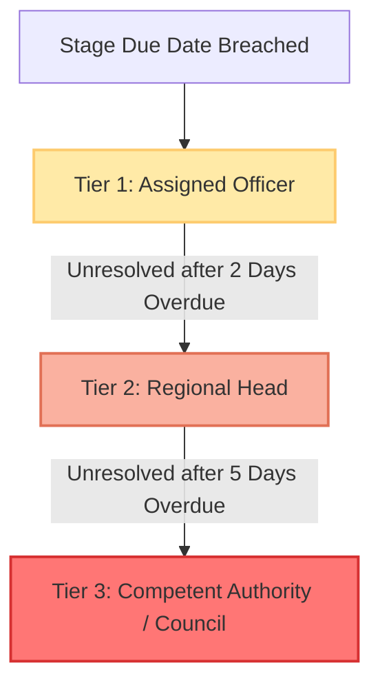

# 05. Alert and Escalation Engine Design

## 1. Core Principles

The Alert and Escalation Engine is the proactive watchdog of the AICTE approval ecosystem. It is governed by three operational principles:
1. **Explainability First**: Every alert must explicitly convey *which rule fired, the triggering data point, the configured threshold, and the APH statutory clause*.
2. **Deterministic Escalation Ladder**: Delays automatically step up the hierarchy (Officer -> Regional Head -> Competent Authority) based on elapsed days.
3. **Actionability**: Every alert includes a direct deep-link to the required resolution action (e.g., "Schedule Inspection Now", "Verify Uploaded Evidence").

---

## 2. Catalog of Alert Types & Trigger Conditions

| Alert Type Code | Entity | Trigger Condition | Default Threshold | Severity | Default Recipient |
| :--- | :--- | :--- | :--- | :--- | :--- |
| `NEAR_BREACH` | Application | `current_stage_elapsed_time >= 80% of SLA` AND `days_remaining <= 2` | 80% SLA / 2 Days | `MEDIUM` | Assigned Scrutiny Officer / Coordinator |
| `OVERDUE` | Application | `current_time > stage_due_date` | 0 Days Remaining | `HIGH` | Assigned Officer + Regional Head |
| `EVC_UNSCHEDULED`| Application | `stage = 'EVC_PENDING'` AND `days_in_stage >= 3` | 3 Days Unscheduled | `HIGH` | EVC Coordinator |
| `UNDERTAKING_DUE`| Undertaking | `today >= (due_date - notification_days)` | 30, 15, 7 Days Prior | `MEDIUM` | Institution User + Regional Desk |
| `UNDERTAKING_OVERDUE`| Undertaking| `today > due_date` AND `status != 'COMPLIED'` | 1 Day Past Due | `CRITICAL` | Regional Head + Institution User |
| `DOCUMENT_EXPIRING`| Document | `today >= (expiry_date - warning_days)` | 90, 60, 30, 7 Days Prior | `MEDIUM` / `HIGH` | Institution User + Regional Head |
| `DOCUMENT_EXPIRED` | Document | `today > expiry_date` AND `renewal_status != 'ACTIVE'` | Expiry date passed | `CRITICAL` | Institution User + Regional Head + Competent Authority |
| `MULTIPLE_REVERTS` | Application | `revert_count >= 2` | 2 Reverts | `HIGH` | Regional Head (Intervention Required) |

---

## 3. The 3-Tier Escalation Ladder

Escalation is evaluated nightly by APScheduler based on `escalation_rules`:



### Escalation Tiers Detail

| Tier Level | Trigger Milestone | Target Role | Automated System Action |
| :--- | :--- | :--- | :--- |
| **Tier 1 (Desk Alert)** | `T_due + 0 hours` | `SCRUTINY_OFFICER` or `EVC_COORDINATOR` | In-app high priority badge; marked as "Overdue" on personal dashboard; reminder email dispatched. |
| **Tier 2 (Regional Escalation)** | `T_due + 48 hours` | `REGIONAL_HEAD` | Added to Regional Head's "Critical Escalations" feed; officer receives managerial warning tag; application flagged on regional board. |
| **Tier 3 (National Council Escalation)**| `T_due + 120 hours` (5 Days) | `COMPETENT_AUTHORITY` (Senior Mgmt) | Included in the National Bottleneck Digest; flagged for discussion in weekly council agenda; options for administrative re-assignment enabled. |

---

## 4. Explainable Alert Structure

To eliminate opaque notifications ("An application requires attention"), every alert generated stores a structured `explanation_meta` JSON payload in the database.

### Schema of `explanation_meta`

```json
{
  "rule_code": "RULE_SCRUTINY_OVERDUE_T2",
  "rule_name": "Scrutiny SLA 48h Escalation",
  "entity_type": "APPLICATION",
  "entity_reference": "AICTE/2026/APP-10023",
  "institution_name": "Apex Institute of Technology, Kanpur",
  "triggering_condition": {
    "field": "days_overdue",
    "actual_value": 3.2,
    "threshold_value": 2.0,
    "unit": "days"
  },
  "aph_legal_basis": "AICTE Approval Process Handbook 2026-27, Chapter II, Clause 2.3 ('Time limits for Scrutiny and Document Verification')",
  "human_readable_explanation": "Application AICTE/2026/APP-10023 has been in Scrutiny for 10.2 days against the standard SLA of 7.0 days. It has exceeded the 2-day grace limit for Tier-1 desk resolution and has automatically escalated to Regional Head oversight.",
  "recommended_action": "Regional Head may reallocate the case to an alternate Scrutiny Officer or summon the desk for immediate expedited clearance."
}
```

### UI Presentation: The Explainable Alert Card
In the UI, clicking any alert chip expands a drawer showing:
1. **Red/Orange Status Banner**: `OVERDUE (3.2 Days Past SLA)`
2. **Context**: Application Number & Institution
3. **The 'Why Did This Fire?' Section**:
   - *Clause Cited*: APH 2026 Chapter II Clause 2.3
   - *Threshold*: 7 Days SLA + 2 Days Tier-2 Grace
   - *Current State*: 10.2 Days in Scrutiny
4. **Direct Action Button**: `[Reassign Officer]` or `[Open Case Review]`

---

## 5. Notification Dispatch Channels

1. **In-App Notification Feed**:
   - Real-time notification bell with unread counter.
   - Filterable by `All`, `Overdue`, `EVC`, and `Document Expiry`.
   - Supports single-click "Mark as Read" or "Acknowledge".

2. **Email Notifications (Console / SMTP Logger)**:
   - Dispatches formatted HTML emails using `communication_templates`:
     - *Subject*: `[AICTE URGENT] Application AICTE/2026/APP-10023 Overdue in Scrutiny`
     - *Body*: Contains institution name, stage history summary, reason for alert, and secure direct action link.

3. **Background Worker Execution (APScheduler)**:
   - **Heartbeat Frequency**: Runs every 15 minutes in demo mode (or configurable via `system_config`).
   - **Evaluated Jobs**:
     - `job_check_stage_slas()`: Computes elapsed hours vs SLA for all `IN_PROGRESS` applications.
     - `job_check_document_expiries()`: Scans `documents` for 90, 60, 30, and 7-day expiry windows.
     - `job_check_undertakings()`: Flags delinquent conditions and overdue submissions.
     - `job_escalate_stalled_alerts()`: Promotes Tier-1 alerts to Tier-2 and Tier-3 if unresolved.
