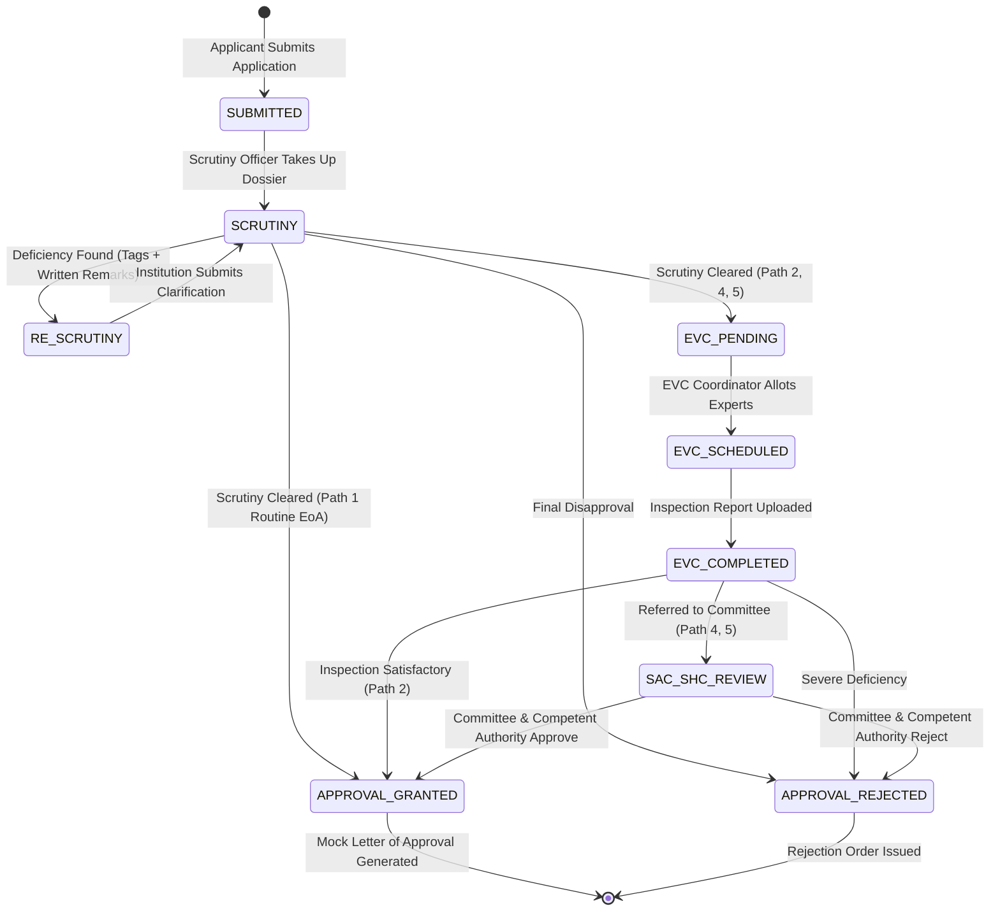

# 10. Phase 3 (Core Engine) Implementation Report

## 1. Executive Summary

Phase 3 (Core Engine) for **SIH26262: Integrated AICTE Approval Workflow Automation, Compliance Monitoring and Alert Management System** has been completed and verified. 

The core engine transforms the Phase 2 foundation into a dynamic, stateful regulatory workflow platform:
- **Deterministic State Machine (`WorkflowEngine`)**: Enforces statutory progression along 5 APH stage paths. Handles normal forward transitions, deficiency return loops with mandatory tagging, configurable revert caps, and final decision recording with statutory Letter of Approval generation.
- **SLA Calculation & Clock Service (`ClockService`)**: Computes stage dwell times, due dates, calendar deadlines, and ageing buckets (`ON_TIME`, `APPROACHING_DUE`, `OVERDUE`). Includes a demo time-travel clock offset mechanism to simulate multi-day delays in real time during hackathon evaluation.
- **Routine Communications (Module A)**: Automatically generates contextual draft communications on procedural milestones (application docketed, stage advanced, deficiency returned, approval granted) for human verification and dispatch.
- **Realistic Synthetic Dataset (60 Applications)**: Replayed deterministic workflow transitions for 60 applications (`AICTE/2026/APP-10001` through `AICTE/2026/APP-10060`) spanning all 5 regions, 5 APH categories, multiple ageing states, and deficiency loops (including Application 27 with 2 reverts).
- **Interactive Web Dossier & Management UI**: Filterable applications table, interactive time-travel clock bar, pathway stepper, SLA countdown meters, drafted communication dispatch, and high-fidelity modal dialogues for stage completion, deficiency returns, and decision orders.
- **Verification**: 18/18 backend pytest tests passing, 0 TypeScript compile errors on Next.js build, and 100% pass rate on the end-to-end smoke test suite.

---

## 2. State Machine Architecture (`WorkflowEngine`)

The workflow engine enforces strict AICTE procedural governance as codified in the Approval Process Handbook (APH 2026-27):



### Key Behavioral Rules:
1. **Linear Spine vs. Branching Stages**:
   - `RE_SCRUTINY` is an asynchronous return branch, not a mandatory forward stage.
   - When advancing along a forward sequence (e.g. `['SUBMITTED', 'SCRUTINY', 'RE_SCRUTINY', 'EVC_PENDING', ...]`), `complete_stage` automatically skips `RE_SCRUTINY` if no deficiency was raised.
2. **Deficiency Return Protocol**:
   - Requires at least 1 valid deficiency tag and detailed written remarks (> 10 characters).
   - If `DEF_OTHER` is selected, specific explanatory text is required.
   - Enforces a configurable cap (default: 2 reverts).
   - If `revert_count >= max_reverts`, the engine flags `escalation_required = True` and records `escalation_reason = "Maximum permitted clarification cycles (2) reached. Dossier escalated to Regional Head for intervention."`
3. **Statutory Decision Authority**:
   - Only `COMPETENT_AUTHORITY` or `ADMIN` can record a final `APPROVE` or `REJECT` decision.
   - Approving an application triggers statutory reference generation (`AICTE/EOA/2026-27/<APP_NUM>`), sets `status = 'APPROVED'`, and synthesizes a structured Letter of Approval document.
   - **Watermark Compliance**: Every generated Letter of Approval visibly carries the immutable notice:
     > `"SAMPLE - SYNTHETIC DEMO DOCUMENT, NOT AN OFFICIAL AICTE ORDER"`

---

## 3. SLA Calculation & Demo Time-Travel Clock

The regulatory lifecycle requires strict deadline adherence. The `ClockService` manages all temporal math:

### Ageing Buckets & Risk Scoring
- **`ON_TIME`**: Days elapsed <= 70% of stage SLA. Delay risk score: 0.0 - 0.5.
- **`APPROACHING_DUE`**: Days elapsed > 70% and <= 100% of stage SLA. Delay risk score: 0.7.
- **`OVERDUE`**: Days elapsed > 100% of stage SLA. Delay risk score: 1.0.

### Formulae:
$$\text{Days In Stage} = \frac{\text{effective\_now} - \text{stage\_entered\_at}}{86400}$$
$$\text{Days Remaining} = \text{default\_sla\_days} - \text{Days In Stage}$$

### Demo Time-Travel Clock
To allow hackathon evaluators to witness SLA degradations, alert triggers, and overdue status changes without waiting days, the system provides:
- `POST /api/v1/demo/advance-clock`: Increments a system-wide temporal offset (in hours).
- `POST /api/v1/demo/reset-clock`: Resets the temporal offset to 0.
- All engine date calculations use `ClockService.get_now() = utcnow() + timedelta(hours=offset)`.

---

## 4. Routine Communications (Module A)

To eliminate manual email drafting and ensure transparency, the system automatically creates draft communications for key milestones:

| Trigger Event | Template Code | Subject | Recipient | Initial Status |
| :--- | :--- | :--- | :--- | :--- |
| **Application Submitted** | `APP_SUBMITTED` | `[AICTE] Application <NUM> Received & Docketed` | Primary Institution Email | `DRAFT` |
| **Stage Advanced** | `STAGE_ADVANCED` | `[AICTE] Application <NUM> Procedural Update: <STAGE>` | Primary Institution Email | `DRAFT` |
| **Deficiency Return** | `DEFICIENCY_NOTICE` | `[AICTE URGENT] Scrutiny Deficiency Notice: <NUM>` | Primary Institution Email | `DRAFT` |
| **Approval Order** | `APPROVAL_ORDER` | `[AICTE ORDER] Extension of Approval 2026-27 Granted: <NUM>` | Primary Institution Email | `DRAFT` |

Officers can review the rendered body in the Application Dossier and dispatch it via `POST /api/v1/applications/{id}/communications/{cid}/mark-sent`.

---

## 5. Seed Dataset Distribution (60 Applications)

The synthetic seed script (`backend/scripts/seed_demo.py`) replays real chronological transitions across all 60 applications:

### Distribution by Current Stage
| Stage Code | Stage Name | Count |
| :--- | :--- | :--- |
| `SUBMITTED` | Submitted & Docketed | 6 |
| `SCRUTINY` | Scrutiny & Document Verification | 18 |
| `RE_SCRUTINY` | Re-Scrutiny / Deficiency Compliance | 8 |
| `EVC_PENDING` | Expert Visit Committee (Pending Allotment) | 10 |
| `EVC_SCHEDULED` | EVC Inspection Scheduled / In-Progress | 6 |
| `SAC_SHC_REVIEW` | Standing Appellate / Hearing Committee Review | 7 |
| `APPROVAL_GRANTED`| Approval Granted (Closed - Approved) | 4 |
| `APPROVAL_REJECTED`| Approval Rejected (Closed - Rejected) | 1 |
| **Total** | | **60** |

### Special Edge Case Verifications
- **Application 27 (`AICTE/2026/APP-10027`)**: Reached 2 deficiency returns (`DEF_LAND_TITLE`, `DEF_FACULTY_CADRE`), hit the revert cap, and has `escalation_required = True`.
- **Approved Applications (Apps 51-54)**: Include generated Letter of Approval records with reference numbers and the demo disclaimer watermark.
- **Time Distribution**: Applications were entered at staggered offsets (-14 days to 0 days), producing realistic mixes of `ON_TIME`, `APPROACHING_DUE`, and `OVERDUE` badges across regional queues.

---

## 6. API Reference (Phase 3 Core Engine)

All endpoints require JWT Bearer authentication and enforce regional/role scoping:

| Method | Endpoint | Allowed Roles | Description |
| :--- | :--- | :--- | :--- |
| `GET` | `/api/v1/applications` | All authenticated | List applications with filters (`stage`, `status`, `region_id`, `ageing`, `search`) |
| `POST` | `/api/v1/applications` | `INSTITUTION_USER`, `ADMIN` | Submit a new regulatory application |
| `GET` | `/api/v1/applications/{id}` | Role/Region scoped | Detailed application dossier, stage history, and SLA status |
| `GET` | `/api/v1/applications/{id}/timeline` | Role/Region scoped | Chronological stage audit trail and transition logs |
| `POST` | `/api/v1/applications/{id}/complete-stage`| Assigned Role, `REGIONAL_HEAD`, `ADMIN` | Advance dossier to the next forward stage |
| `POST` | `/api/v1/applications/{id}/return` | `SCRUTINY_OFFICER`, `REGIONAL_HEAD`, `ADMIN` | Return for clarification with deficiency tags |
| `POST` | `/api/v1/applications/{id}/decision` | `COMPETENT_AUTHORITY`, `ADMIN` | Record final statutory `APPROVE` or `REJECT` |
| `POST` | `/api/v1/applications/{id}/communications/{cid}/mark-sent` | Officers, `ADMIN` | Dispatch drafted communication |
| `GET` | `/api/v1/config/deficiency-tags` | All authenticated | List 9 standard statutory deficiency tags |
| `GET` | `/api/v1/config/application-categories` | All authenticated | List 5 APH application categories and path mappings |
| `POST` | `/api/v1/demo/advance-clock` | `ADMIN` | Fast-forward the demo time-travel clock |
| `POST` | `/api/v1/demo/reset-clock` | `ADMIN` | Reset demo time-travel clock to current UTC |

---

## 7. Frontend Features & User Experience

### 1. Applications Directory (`/applications`)
- **Filter Bar**: Search by application number, institution name, or city. Filter by Stage, SLA Ageing Bucket, and Region.
- **SLA Badges**: Visual indicators (`ON_TIME` in green, `APPROACHING_DUE` in amber, `OVERDUE` in red) with countdown chips (`"2.4d left"` or `"+1.5d late"`).
- **Demo Clock Control**: Floating top bar widget to advance the simulation clock by 24h, 48h, or 7 days, or reset it.
- **New Application Modal**: Form for institutions to submit new applications under any APH category.

### 2. Case Dossier Screen (`/applications/[id]`)
- **Visual Pathway Stepper**: Displays all milestones of the application's assigned stage path. Highlights current stage, completed stages, and deficiency return loops.
- **SLA Countdown Meter**: Dynamic progress bar displaying elapsed dwell time against the stage deadline.
- **Action Dialogues**:
  - **Complete Stage**: Modal to submit officer remarks and advance the dossier.
  - **Return for Clarification**: Interactive deficiency tag selector (9 tags), mandatory reason input, and revert cap warning.
  - **Record Decision**: Restricted to Competent Authority/Admin with decision selector (`APPROVE`/`REJECT`).
  - **Letter of Approval Modal**: High-fidelity official order document with AICTE header, reference number, institutional details, and prominent demo watermark.
- **Drafted Communications Panel**: Review generated notices with a one-click "Mark as Sent" dispatch button.
- **Procedural Timeline**: Visual audit history with actor details, timestamps, remarks, and deficiency tags.

---

## 8. Verification & Test Results

### Pytest Backend Suite
```
tests/test_auth_and_rbac.py::test_health PASSED                          [  5%]
tests/test_auth_and_rbac.py::test_login_success PASSED                   [ 11%]
tests/test_auth_and_rbac.py::test_login_failure PASSED                   [ 16%]
tests/test_auth_and_rbac.py::test_demo_login_regional_head PASSED        [ 22%]
tests/test_auth_and_rbac.py::test_demo_login_all_roles PASSED            [ 27%]
tests/test_auth_and_rbac.py::test_token_protection PASSED                [ 33%]
tests/test_auth_and_rbac.py::test_rbac_institution_scoping PASSED        [ 38%]
tests/test_auth_and_rbac.py::test_rbac_regional_head_scoping PASSED      [ 44%]
tests/test_auth_and_rbac.py::test_rbac_admin_scope PASSED                [ 50%]
tests/test_auth_and_rbac.py::test_audit_log_written_on_login PASSED      [ 55%]
tests/test_auth_and_rbac.py::test_config_endpoints PASSED                [ 61%]
tests/test_workflow_engine.py::test_seed_integrity_and_distribution PASSED [ 66%]
tests/test_workflow_engine.py::test_state_machine_all_5_paths PASSED     [ 72%]
tests/test_workflow_engine.py::test_role_and_regional_permissions PASSED [ 77%]
tests/test_workflow_engine.py::test_revert_validation_and_cap PASSED     [ 83%]
tests/test_workflow_engine.py::test_closed_application_guard PASSED      [ 88%]
tests/test_workflow_engine.py::test_sla_calculation_and_demo_clock_advance PASSED [ 94%]
tests/test_workflow_engine.py::test_applications_api_endpoints PASSED    [100%]

======================== 18 passed in 1.68s ========================
```

### End-to-End Smoke Test
```
=== SIH26262 SMOKE TEST SUITE (PHASES 1-3) ===
1. Checking GET /health ... PASSED (Database Healthy)
2. Checking POST /api/v1/auth/demo-login (Admin) ... PASSED
3. Checking Regional Scoping /users/me/scope ... PASSED (Regional Scope Verified)
4. Checking GET /api/v1/config/deficiency-tags ... PASSED (9 Tags Present)
5. Checking GET /api/v1/applications (Seeded 60 Applications) ... PASSED
6. End-to-End Workflow Transition Lifecycle ... PASSED (Approval Letter & Watermark Verified)
7. Checking Demo Clock Advance (+24 Hours) ... PASSED
=== ALL PHASE 3 SMOKE CHECKS PASSED SUCCESSFULLY ===
```

---

## 9. Phase 4 Readiness: Alert Rules Engine & Watchers

The platform is now ready for **Phase 4: Alert Rules Engine, Scheduler & Escalation Ladder**:
1. **Rule Engine Service**: Evaluates 8 pre-seeded statutory rules against real application states.
2. **Escalation Ladder**: Automatically routes reminders (`Level 1`) to Scrutiny Officers, warnings (`Level 2`) to Regional Heads, and escalations (`Level 3`) to the Member Secretary.
3. **Background Scheduler**: Periodic task runner to scan for expiring documents, pending EVC visits, and overdue SLAs.
