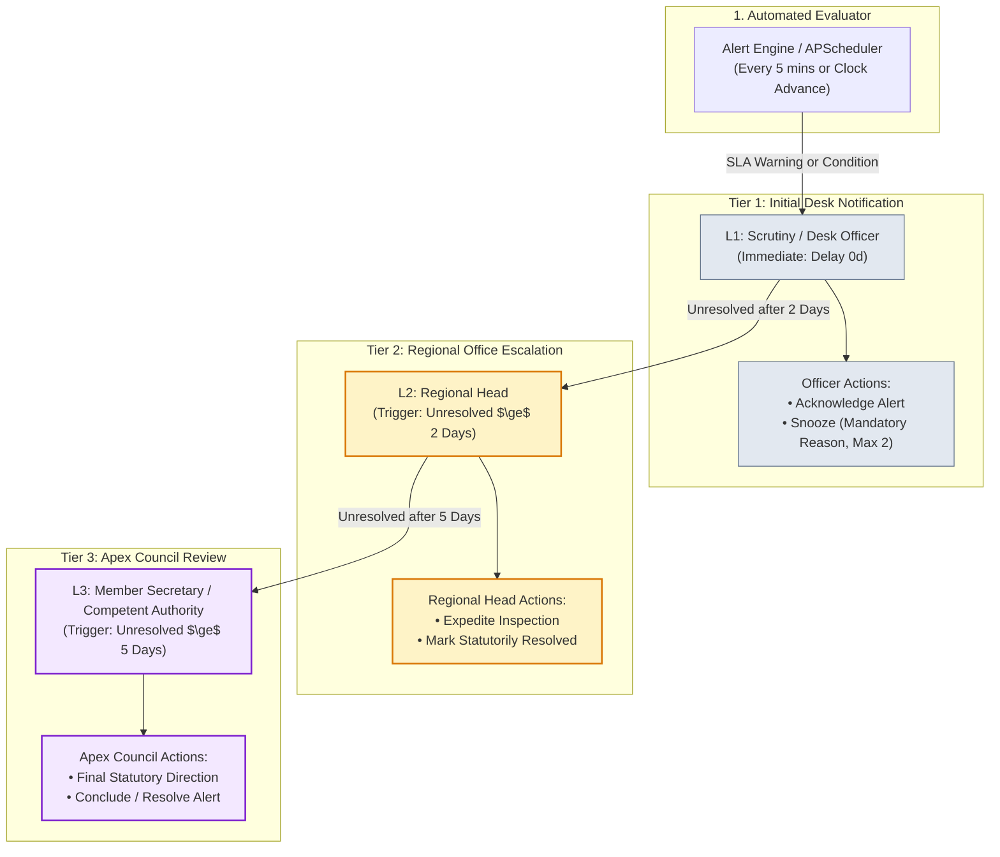

# Phase 4 Completion Report: Watchers, Alert Rules Engine, Escalation Ladder & Notifications

**System:** AICTE Approval Workflow Automation & Compliance Monitoring System (SIH26262)  
**Phase:** 4 (Watchers: Alert Engine, APScheduler, Escalation Ladder, In-App Notifications, Outbox & Explainable UI)  
**Status:** **APPROVED & IMPLEMENTED**  
**Source of Truth:** `/docs` and `db/schema.sql`

---

## 1. Executive Summary

Phase 4 introduces the real-time compliance guardian for AICTE. The Alert Rules Engine, APScheduler daemon, 3-tier escalation ladder, and in-app/email notification infrastructure continuously monitor applications, inspection committee schedules, conditional undertakings, and statutory institutional documents.

### Statutory Invariance Commitment
> **Crucial Rule Maintained:** Automation only observes, notifies, and escalates. It **never** decides, approves, rejects, or reverts an application. Human officers remain solely empowered to make statutory determinations. All alerts and notifications carry transparent, explainable rationales derived directly from database-configured thresholds.

---

## 2. Statutory Alert Rules Engine Matrix (11 Active + 1 Advisory Rule)

Following Phase 7 extension, all **11 active statutory rules** plus **1 early-warning advisory rule** (`RULE_RISK_HIGH`) are loaded directly from the `alert_rules` and `system_config` tables. Zero thresholds are hard-coded in Python.

| Rule Code | Monitored Entity | Trigger Condition | Day Basis | Threshold Source | Default Severity | Regulatory Clause |
| :--- | :--- | :--- | :--- | :--- | :--- | :--- |
| `RULE_SCRUTINY_NEAR_BREACH` | `APPLICATION` | Stage time elapsed $\ge$ 80% of stage SLA | Working Days | `system_config.alert_thresholds.near_breach_percent` | `MEDIUM` | APH 2026 Chapter II Clause 2.1 |
| `RULE_SCRUTINY_OVERDUE` | `APPLICATION` | Current time $>$ `stage_due_date` | Working Days | `stage.default_sla_days` | `HIGH` | APH 2026 Chapter II Clause 2.2 |
| `RULE_EVC_UNSCHEDULED` | `EVC_VISIT` | Status `SCHEDULED` not set within threshold | Calendar Days | `system_config.sla_rules.EVC_PENDING_TO_SCHEDULE` | `HIGH` | APH 2026 Chapter III Clause 3.4 |
| `RULE_EVC_VISIT_OVERDUE` | `EVC_VISIT` | Scheduled visit date passed without report | Working Days | `system_config.sla_rules.EVC_VISIT_TO_REPORT` | `HIGH` | APH 2026 Chapter III Clause 3.6 |
| `RULE_UNDERTAKING_DUE_15D` | `UNDERTAKING` | Status `PENDING` and due within 15 days | Calendar Days | `alert_rules.condition_logic.days_remaining <= 15` | `MEDIUM` | APH 2026 Chapter I Clause 1.8 |
| `RULE_UNDERTAKING_OVERDUE` | `UNDERTAKING` | Status `PENDING` and `due_date` has passed | Calendar Days | `alert_rules.condition_logic.days_remaining < 0` | `HIGH` | APH 2026 Chapter I Clause 1.9 |
| `RULE_LEASE_90D` | `DOCUMENT` | Land lease / FDR expiring in $\le$ 90 days | Calendar Days | `alert_rules.condition_logic.days_to_expiry <= 90` | `MEDIUM` | APH 2026 Appendix 4 Clause 4.2 |
| `RULE_LEASE_30D` | `DOCUMENT` | Land lease / FDR expiring in $\le$ 30 days | Calendar Days | `alert_rules.condition_logic.days_to_expiry <= 30` | `HIGH` | APH 2026 Appendix 4 Clause 4.3 |
| `RULE_FIRE_NOC_EXPIRED` | `DOCUMENT` | Fire Safety NOC `expiry_date` has elapsed | Calendar Days | `alert_rules.condition_logic.days_to_expiry <= 0` | `CRITICAL` | APH 2026 Appendix 4 Clause 4.4 |
| `RULE_DOCUMENT_EXPIRED` | `DOCUMENT` | Prescribed lease/FDR/doc expired without verified renewal | Calendar Days | `alert_rules.condition_logic.days_to_expiry <= 0` | `HIGH` | APH 2026 Appendix 4 Clause 4.5 |
| `RULE_MULTIPLE_REVERTS` | `APPLICATION` | Application reverted $\ge$ 2 times | Event/Count | `alert_rules.condition_logic.revert_count >= 2` | `HIGH` | APH 2026 Chapter II Clause 2.5 |
| `RULE_RISK_HIGH` | `APPLICATION` | 4-Factor Delay Risk Score reaches High band ($\ge$ 70) | Rule Score | `system_config.risk_score_thresholds.high` | `INFO` | APH 2026 Early-Warning Notice |

*Note on Regulatory Clauses:* Per user guidance, all APH clause citations display with a prominent `(sample reference)` marker in the user interface unless explicitly marked as verified in system configuration. All Phase 7 innovation rules carry the persistent *"Decision support only"* badge.

---

## 3. Escalation Ladder & Workflow Architecture

The escalation ladder enforces a strict 3-tier hierarchy governed by `escalation_rules`. When an alert remains unacknowledged or unresolved past configured day limits, the scheduler automatically elevates the alert, creates a high-priority in-app notification for the superior officer, and queues an email draft in the database outbox.

### Escalation Hierarchy Mermaid Diagram

### Escalation Ladder Rules & Safeguards
1. **Tier Progression**: Tier 1 (Assigned Desk Officer, 0d) $\rightarrow$ Tier 2 (Regional Head, 2d) $\rightarrow$ Tier 3 (Competent Authority / Member Secretary, 5d).
2. **Role Naming Decision**: No separate `MEMBER_SECRETARY` role was added to the database. Per User Decision #1, `COMPETENT_AUTHORITY` serves as the apex role, displayed with the title *"Member Secretary / Competent Authority"* in the user interface.
3. **Snooze Invariance**: An officer may snooze an active alert with a mandatory substantive reason. However:
   - Snoozing is strictly capped at `max_snooze_limit` (configured as 2).
   - **Snoozing never suppresses upward escalation**: once the calendar days reach the trigger threshold (e.g. 2 days or 5 days), the alert automatically escalates to Tier 2 or Tier 3 regardless of snooze state.
4. **Resolution Permissions**: Only the Competent Authority, Regional Head, or System Admin can mark an alert resolved with a mandatory written justification.

---

## 4. Email Outbox & Communication System

To ensure zero unwanted SMTP traffic during development while maintaining full operational visibility:
- **`EMAIL_SEND_ENABLED=false` (Default)**: Outgoing emails generated by alerts or status changes are written to the `email_outbox` table with status `SUPPRESSED` (or `QUEUED`). They remain fully inspectable through the Admin Outbox Viewer (`/admin/outbox`).
- **`EMAIL_SEND_ENABLED=true`**: When activated, the outbox processor connects to the configured SMTP credentials in `.env`, transmits the message, increments `attempts`, and marks the record `SENT`.
- **Synthetic Email Addresses**: All seeded user and institution emails strictly use clearly fake demo addresses (e.g., `*.aicte.gov.in`, `principal@apexkanpur.edu`).

---

## 5. API Endpoint Catalog (Phase 4)

All Phase 4 endpoints are mounted under `/api/v1`, enforce RBAC security, and are published in OpenAPI Swagger (`/docs`):

| Method | Endpoint | Allowed Roles | Description |
| :--- | :--- | :--- | :--- |
| `GET` | `/alerts` | All Officers & Admin | List alerts with filters (severity, status, rule, tier, search) and RBAC scoping. |
| `GET` | `/alerts/summary` | All Officers & Admin | Counts of open alerts grouped by severity, status, tier level, and region. |
| `GET` | `/alerts/{id}` | All Officers & Admin | Complete alert explanation payload, entity metadata, and escalation history trail. |
| `POST` | `/alerts/{id}/acknowledge` | Officers & Admin | Acknowledge alert responsibility with optional remarks. |
| `POST` | `/alerts/{id}/snooze` | Officers & Admin | Snooze alert for 12/24/48/72 hours. Validates mandatory reason and max snooze limit. |
| `POST` | `/alerts/{id}/resolve` | Regional Head, Competent Auth, Admin | Mark alert statutorily resolved with mandatory remark. |
| `POST` | `/alerts/run-now` | Admin & Authorized Officers | Manually trigger idempotent rule evaluation & escalation ladder scan. |
| `GET` | `/escalation/matrix` | All Officers & Admin | Regional escalation hierarchy mapping (L1, L2, L3 officers and alert counts). |
| `GET` | `/notifications` | All Authenticated Users | In-app notification center with read/unread filter and unread count. |
| `POST` | `/notifications/{id}/read` | Notification Recipient | Mark single in-app notification as read. |
| `POST` | `/notifications/read-all` | All Authenticated Users | Mark all notifications for current user as read. |
| `GET` | `/outbox` | Admin | Inspect database email outbox queue with body preview and transmission logs. |
| `GET` | `/config/alert-rules` | Admin | Inspect all 8 configurable statutory alert engine rules. |
| `PUT` | `/config/alert-rules/{id}` | Admin | Edit alert rule severity, condition logic, activation status, or APH clause. |
| `GET` | `/config/escalation-rules` | Admin | Inspect 3-tier escalation rules and trigger day thresholds. |
| `PUT` | `/config/escalation-rules/{id}` | Admin | Edit escalation delay days or statutory action required text. |

---

## 6. Seed Data & Initial Alert Spread

`make seed-demo` idempotently seeds a full compliance environment:
- **60 Demo Applications** across 5 regions.
- **12 EVC Inspection Visits**: unscheduled, scheduled, overdue, and completed.
- **20 Conditional Undertakings**: valid, due within 15 days, and overdue.
- **25 Statutory Documents**: valid, expiring within 90/30 days, expired Fire NOCs, and FDRs.

### Initial Alert Distribution (Real Database Counts)
- **Total Open Alerts**: `61`
- **By Severity**:
  - `CRITICAL`: 5 (Expired Fire NOCs requiring immediate safety halt)
  - `HIGH`: 22 (Scrutiny overdue, EVC unscheduled, expired land lease, multiple reverts)
  - `MEDIUM`: 34 (Near breach at $\ge 80\%$ SLA, undertaking due soon, lease expiring in 90 days)
- **By Rule**:
  - `RULE_SCRUTINY_NEAR_BREACH`: 19
  - `RULE_SCRUTINY_OVERDUE`: 11
  - `RULE_UNDERTAKING_DUE_15D`: 10
  - `RULE_EVC_UNSCHEDULED`: 5
  - `RULE_LEASE_90D`: 5
  - `RULE_LEASE_30D`: 5
  - `RULE_FIRE_NOC_EXPIRED`: 5
  - `RULE_MULTIPLE_REVERTS`: 1

---

## 7. Verification & Automated Test Results

### 1. Pytest Backend Suite (27/27 Tests Passing)
- **Alert Rule Tests**: Verified each rule fires at statutory threshold and does not fire before threshold.
- **Deduplication & Auto-Resolution**: Confirmed exactly one open alert per entity/rule; auto-resolves when condition clears (e.g. document renewed).
- **Severity Upgrade**: Confirmed transition from near-breach to overdue upgrades severity while retaining audit history.
- **Escalation Ladder & History**: Confirmed L1 $\rightarrow$ L2 $\rightarrow$ L3 progression, `escalation_history` row creation, and in-app notification dispatch.
- **Snooze Limits**: Verified max snooze cap (raises HTTP 400 upon third attempt).
- **Time-Travel Clock Integration**: Advancing clock dynamically triggers evaluation and creates overdue alerts.
- **Statutory Invariance**: Verified that no alert code path modifies application stage, status, or revert counts.
- **Concurrency Guard**: Proved that `_evaluation_lock` skips concurrent runs to guarantee thread safety.

### 2. End-to-End Smoke Test (`./scripts/smoke_test.sh`)
- Check 1: GET `/health` $\rightarrow$ PASSED
- Check 2: POST `/api/v1/auth/demo-login` (Admin) $\rightarrow$ PASSED
- Check 3: GET `/api/v1/users/me/scope` (Regional Scoping) $\rightarrow$ PASSED
- Check 4: GET `/api/v1/config/deficiency-tags` $\rightarrow$ PASSED
- Check 5: GET `/api/v1/applications` (60 Applications) $\rightarrow$ PASSED
- Check 6: Workflow Lifecycle (Submit $\rightarrow$ Scrutiny $\rightarrow$ Revert $\rightarrow$ Clarify $\rightarrow$ Approve) $\rightarrow$ PASSED
- Check 7: Advance Demo Clock (+24h) $\rightarrow$ PASSED
- Check 8: POST `/api/v1/alerts/run-now` (Manual Evaluation Trigger) $\rightarrow$ PASSED
- Check 9: GET `/api/v1/alerts/summary` (61 Open Alerts) $\rightarrow$ PASSED
- Check 10: POST `/api/v1/alerts/{id}/acknowledge` $\rightarrow$ PASSED
- Check 11: GET `/api/v1/escalation/matrix` (5 Regional Offices) $\rightarrow$ PASSED
- Check 12: GET `/api/v1/notifications` & GET `/api/v1/outbox` $\rightarrow$ PASSED

### 3. Frontend Next.js Production Build
- `npm run build` executed with **0 lint or type errors**. All 16 routes compiled and prerendered cleanly.
