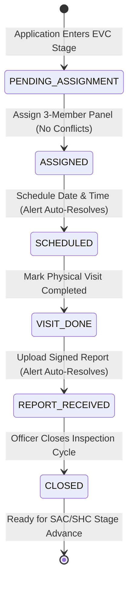
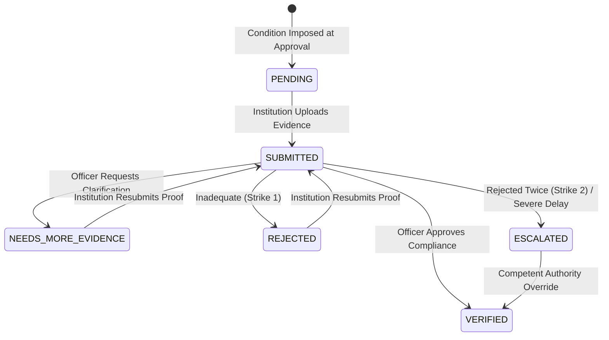
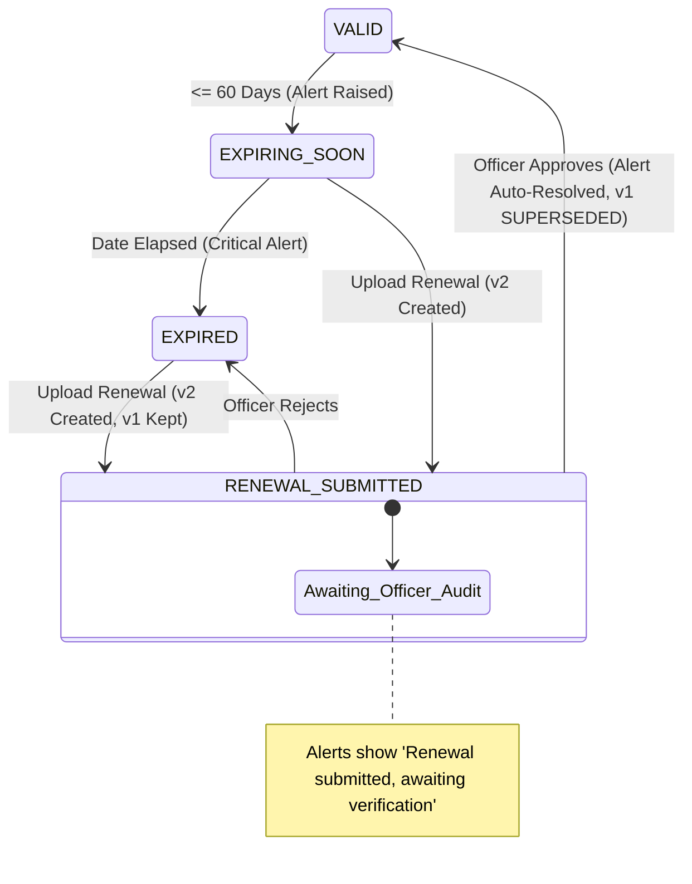

# Phase 5 Implementation Report: Operational Screens & Executive Reports

**Project:** SIH26262 - Integrated AICTE Approval Workflow Automation, Compliance Monitoring and Alert Management System  
**Phase:** 5 (Operational Screens: EVC Queue, Undertaking Tracker, Document Validity Tracker, Reports Suite, Institution Portal)  
**Status:** Approved & Implemented  
**Date:** October 2026  

---

## 1. Executive Summary

Phase 5 delivers the end-to-end operational frontend screens and executive reporting suite for Modules C, D, E, and F, along with a dedicated, strictly scoped **Institution Portal**. Automation strictly serves as an operational decision-support layer for regional officers and committee coordinators—it never auto-approves, auto-rejects, or bypasses statutory mandates.

Every visual metric across all 5 executive reports is calculated directly from active PostgreSQL database records, with export capabilities in standard CSV and formal PDF formats.

---

## 2. Operational Screens & Routes

| Route | Role Access | Module | Key Capabilities |
|---|---|---|---|
| `/evc-queue` | EVC Coordinator, Regional Head, Admin | Module C | 3-member panel constitution, conflict checks (city & concurrency limit), date/time scheduling, physical completion tracking, report uploading, and month calendar toggle. |
| `/undertakings` | Scrutiny Officer, Regional Head, Competent Authority, Admin | Module D | Multi-attribute filtering, evidence file viewer/download, officer determination (`VERIFIED`, `REJECTED`, `NEEDS_MORE_EVIDENCE`), 2-strike council escalation, and audit timeline. |
| `/document-validity` | Scrutiny Officer, Regional Head, Admin | Module E | Expiry queue sorted by regulatory urgency, multi-version supersede history (`v1 -> v2`), and renewal verification with deferred alert auto-resolution. |
| `/reports` | All Officers & Admin | Module F | 5 interactive reports (Recharts Bar/Pie) + 360° Institution Health Dossier. On-demand CSV and formal PDF exports. |
| `/portal` | Institution User (Strict Scope) | Applicant Self-Service | Application milestone stepper, SLA deadlines, active deficiency flags, notices dispatched, and sample order viewer (`SAMPLE` watermark). |
| `/portal/undertakings` | Institution User | Applicant Compliance | Own undertakings registry, due date countdowns, and multi-file evidence upload dialog. |
| `/portal/documents` | Institution User | Applicant Compliance | Own monitored statutory certificates, validity countdown, and renewal dossier upload modal. |

---

## 3. API Endpoints Implemented

### Module C: EVC Inspection Lifecycle (`/api/v1/evc`)
- `GET /api/v1/evc/visits`: List EVC visits with regional and status filters.
- `GET /api/v1/evc/visits/{id}`: Detailed visit dossier including panel profile.
- `GET /api/v1/evc/experts`: Seeded pool of synthetic academic experts.
- `GET /api/v1/evc/visits/{id}/suggested-experts`: Decision-support ranked suggestions with plain-English conflict detection.
- `POST /api/v1/evc/visits/{id}/assign-panel`: Confirms statutory 3-member panel (enforcing conflict and $\le 2$ concurrency rules).
- `POST /api/v1/evc/visits/{id}/schedule`: Sets date, time slot, and inspection instructions; auto-resolves `RULE_EVC_UNSCHEDULED`.
- `POST /api/v1/evc/visits/{id}/complete-visit`: Records physical site completion timestamp and summary.
- `POST /api/v1/evc/visits/{id}/upload-report`: Uploads signed committee report; auto-resolves `RULE_EVC_VISIT_OVERDUE`.
- `POST /api/v1/evc/visits/{id}/close`: Concludes EVC cycle, enabling stage advance in case file.

### Module D: Undertakings & Compliance (`/api/v1/undertakings`)
- `GET /api/v1/undertakings`: List undertakings with regional and urgency scoping.
- `GET /api/v1/undertakings/{id}`: Full detail with evidence files and lifecycle history.
- `POST /api/v1/undertakings/{id}/upload-evidence`: Multipart upload for evidence files; transitions state to `SUBMITTED`.
- `POST /api/v1/undertakings/{id}/verify`: Officer verification (`VERIFIED`, `REJECTED`, `NEEDS_MORE_EVIDENCE`); 2nd rejection triggers council escalation.

### Module E: Document Validity & Renewals (`/api/v1/documents`)
- `GET /api/v1/documents`: List documents with urgency buckets (`EXPIRED`, `CRITICAL`, `EXPIRING_SOON`, `VALID`).
- `GET /api/v1/documents/{id}`: Document detail with multi-version supersede history chain.
- `POST /api/v1/documents/{id}/upload-renewal`: Creates new version (`v{n+1}`), sets status `RENEWAL_SUBMITTED`, keeps alerts in interim status.
- `POST /api/v1/documents/{id}/verify-renewal`: Officer approval supersedes old version, marks new version `VALID`, and auto-resolves linked alerts.

### Module F: Executive Reports & Health Dossier (`/api/v1/reports`)
- `GET /api/v1/reports/pendency`: Real-time pendency and ageing by stage, region, and scrutiny officer.
- `GET /api/v1/reports/evc`: EVC turnaround days and status distribution.
- `GET /api/v1/reports/undertakings`: Compliance rates, on-time vs overdue breakdowns.
- `GET /api/v1/reports/documents`: Validity matrix across certificate types.
- `GET /api/v1/reports/regional-performance`: Cross-regional SLA breach rates, alerts raised vs resolved.
- `GET /api/v1/reports/export/csv`: Export dataset as CSV.
- `GET /api/v1/reports/export/pdf`: Generates formal PDF docket via `fpdf2`.
- `GET /api/v1/reports/institutions/{id}/health`: 360° compliance health score (0-100) and regulatory dossier.

### File Handling (`/api/v1/files`)
- `POST /api/v1/files/upload`: Secure multipart upload (PDF, PNG, JPG $\le 10$ MB), SHA-256 verification.
- `GET /api/v1/files/{file_id}/download`: RBAC-authorized streaming download.

---

## 4. State Transition Diagrams

### A. EVC Lifecycle

### B. Undertaking Verification & Escalation

### C. Document Renewal & Versioning

---

## 5. Seed Database Statistics (`make seed-demo`)

- **Synthetic Experts (`evc_experts`)**: 15 experts distributed across all 5 AICTE regions (Northern, Western, Southern, Eastern, South-Western) covering Civil, Mechanical, Computer Science, Electrical, and Pharmacy disciplines.
- **EVC Visits (`evc_visits`)**: 12 visits spanning all 6 statutory states (`PENDING_ASSIGNMENT`, `ASSIGNED`, `SCHEDULED`, `VISIT_DONE`, `REPORT_RECEIVED`, `CLOSED`).
- **Undertakings (`undertakings`)**: 20 time-bound conditions across all statuses with uploaded evidence files and full audit trails in `undertaking_history`.
- **Statutory Documents (`documents`)**: 25 documents with multi-version chains (including Land Leases, Fire NOCs, FDR Guarantees, and Building Plans).
- **Uploaded Files (`uploaded_files`)**: Synthetic PDF and certificate records stored with SHA-256 checksums.

---

## 6. Test Suite & Validation Results

### Backend Test Suite (`pytest`)
All 38 tests across the system pass with **100% success**:
- `tests/test_phase5_screens.py`: 11 passed (EVC panel size, conflict checks, concurrency limits, alert auto-resolution, 2-strike escalation, document versioning, institution scoping, report exports, file security).
- `tests/test_alert_watchers.py`: 9 passed.
- `tests/test_workflow_engine.py`: 8 passed.
- `tests/test_auth_and_rbac.py`: 10 passed.

### End-to-End Smoke Test (`./scripts/smoke_test.sh`)
All 17 integration checks pass:
1. Health check (Database healthy)
2. Admin demo login
3. Regional scoping verification
4. Deficiency tags (9 standard tags)
5. Applications list (60 seeded applications)
6. End-to-end workflow transition lifecycle (Submit $\to$ Scrutiny $\to$ Revert $\to$ Clarify $\to$ Sample Order with watermark)
7. Demo clock advance (+24 hours)
8. Scheduler run-now manual trigger
9. Alert summary counts
10. Alert acknowledgement
11. Regional escalation matrix
12. Notification and email outbox dispatch
13. **EVC panel assignment & scheduling lifecycle**
14. **Undertaking evidence submission & officer verification**
15. **Document renewal versioning & officer verification**
16. **Reports DB calculations & CSV/PDF exports**
17. **Strict institution scoping guard (HTTP 404 blocked on foreign records)**

### Frontend Production Build (`npm run build`)
Compiled successfully into 18 static/dynamic routes with zero TypeScript or styling warnings.
