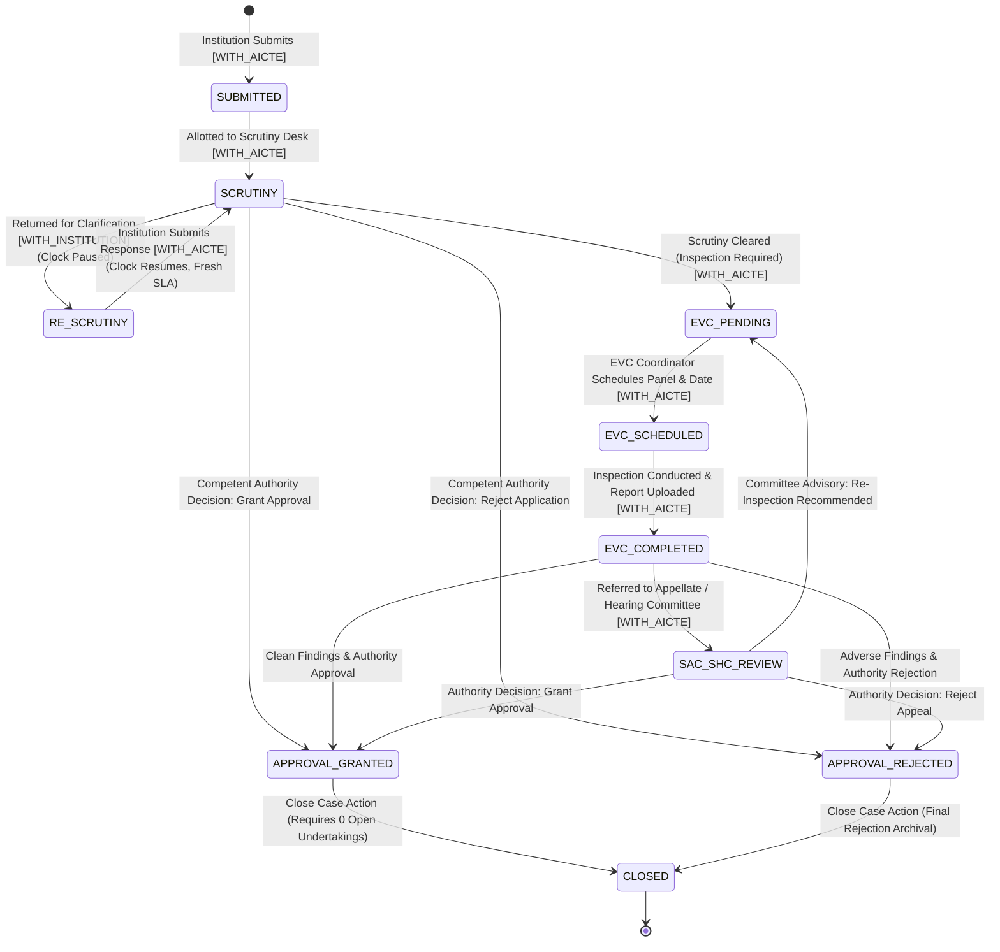

# Phase 6 Implementation Report: Build Plan v2 Alignment

**Project:** SIH26262 - Integrated AICTE Approval Workflow Automation, Compliance Monitoring and Alert Management System  
**Phase:** 6 (v2 Alignment: Fair Pendency Clock, Working-Day Calendar, CLOSED State, Overdue Cases Report, Two New Roles)  
**Status:** Completed & Fully Verified  
**Date:** October 2026  

---

## 1. Executive Summary & Scope

Phase 6 brings the AICTE approval engine into complete alignment with **Build Plan v2** (Sections 3, 4, 9, 12, and 14). All changes were introduced through additive, backward-compatible Alembic migrations without breaking, rebuilding, or renaming existing tables, stages, or roles.

### Core Deliverables Achieved
1. **Two New Roles**: `BUREAU_OFFICER` (cross-region, read-focused operational oversight) and `COMMITTEE_MEMBER` (advisory observations on assigned cases).
2. **Fair Pendency Clock**: Explicit case holder (`WITH_AICTE` vs `WITH_INSTITUTION`), immutable `clock_segments`, automatic pause upon return for clarification, and automatic resumption upon institution response.
3. **Working-Day Calendar**: Configurable weekend (`weekend_days`) and holidays table, `WorkingDayService` used across deadline calculations, and rule `day_basis` (`WORKING` vs `CALENDAR`).
4. **Statutory Closed State**: Terminal `CLOSED` stage with mandatory statutory reasons, blocked by open/unverified undertakings, alert auto-resolution, and read-only enforcement.
5. **Overdue Cases Report**: Sixth compliance report querying applications (AICTE-held time only), EVC visits, undertakings, and expired documents from PostgreSQL with CSV and PDF export.
6. **Decision Support Labeling**: Universal "Decision support only" badge with interactive tooltip, making transparent that automation assists officers but never makes decisions.
7. **Zero Regression Guarantee**: All 38 existing tests continue to pass; 17 new Phase 6 unit/integration tests added (55 total passing), and the end-to-end smoke test script extended to 22 passing checks.

---

## 2. Updated State Machine & Fair Pendency Architecture



### Fair Pendency Clock Segment Lifecycle
Every application lifecycle movement is partitioned into immutable records in `clock_segments`:
- **Active AICTE Processing**: `holder = "WITH_AICTE"`. Time elapsed counts against stage SLA, ageing buckets, and near-breach/overdue alerts.
- **Clarification Pause**: `holder = "WITH_INSTITUTION"`. Triggered whenever an application is returned for deficiencies. Time elapsed while with institution is strictly excluded from AICTE processing SLA.
- **Alert Suppression**: Near-breach and overdue alerts are suppressed while `case_holder == "WITH_INSTITUTION"`. Any pre-existing active breach alerts on that application are automatically resolved with recorded remarks: `"clock paused: with institution"`.
- **Clock Resumption**: When an applicant institution submits an `institution-response`, the active `WITH_INSTITUTION` segment is closed with exact duration, `case_holder` transitions back to `"WITH_AICTE"`, and a fresh working-day SLA is assigned.

---

## 3. Two New Roles & RBAC Matrix

### Role Definition & Scope
| Role Code | Title | Operational Scope | Permitted Actions | Prohibited Actions |
|---|---|---|---|---|
| `BUREAU_OFFICER` | Bureau Officer | Central Bureau / Directorate (Cross-Region) | View national & regional pendency, bottleneck reports, inspect dossiers, acknowledge alerts with remarks. | Cannot complete stages, decide approvals/rejections, close cases, or verify compliance. |
| `COMMITTEE_MEMBER` | Committee Member (EVC / SAC / SHC) | Assigned cases only | View visit/meeting schedule for assigned committee cases, record observations and non-binding advisory recommendations (`RECOMMEND_APPROVAL`, `RECOMMEND_REJECTION`, `RECOMMEND_RE_INSPECTION`, `NEEDS_CLARIFICATION`). | Cannot advance stages, render decisions, or mutate application state. |

> **Plan v2 Regional Officer Mapping Note**: Plan v2 refers generally to "Regional Officer". In this codebase:
> - Desk scrutiny, deficiency returns, and field logistics are handled by **`SCRUTINY_OFFICER`**.
> - Jurisdictional administration, regional performance oversight, escalation resolution, and regional case closures are handled by **`REGIONAL_HEAD`**.

### Updated RBAC Permissions Matrix
| Functional Action | `ADMIN` | `SCRUTINY` | `EVC_COORD` | `REGIONAL_HEAD` | `COMPETENT_AUTH` | `INSTITUTION` | `BUREAU_OFFICER` | `COMMITTEE_MEMBER` |
|---|:---:|:---:|:---:|:---:|:---:|:---:|:---:|:---:|
| **View Dashboard** | All Regions | Assigned | EVC Queue | Regional | National | Own Inst. | Cross-Region | Assigned Only |
| **Complete Stage** | Full | Yes (Desk) | Yes (EVC) | Yes (Regional) | Full | In Re-Scrutiny | - | - |
| **Return Application** | Full | Yes (Reason) | - | Yes (Reason) | - | - | - | - |
| **Institution Response** | Full | - | - | - | - | **Full** | - | - |
| **Record Decision** | - | - | - | Recommend | **Final Authority** | - | - | - |
| **Record Observation** | - | - | - | - | - | - | - | **Advisory Only** |
| **Close Case** | **Full** | - | - | **Yes (Regional)** | **Full** | - | - | - |
| **Acknowledge Alert** | Full | Assigned | Assigned | Regional | National | - | **Yes (Remark Req)** | - |
| **Manage Holidays** | **Full** | - | - | - | - | - | - | - |

---

## 4. Working-Day Calendar Engine

### Service Architecture: `WorkingDayService`
All timeline and SLA calculations throughout the application are centralized in `app/services/working_day_service.py`:
- `add_working_days(db, start, n_days, region_id)`: Advances dates while skipping weekends and active national/regional holidays.
- `working_days_between(db, start, end, region_id)`: Computes the net working days elapsed between two timestamps.
- `is_holiday_or_weekend(db, date, region_id)`: Returns whether a date is non-working, along with an explanation (e.g., `"Weekend (Sunday)"` or `"Holiday: Republic Day"`).

### Rule-Level `day_basis` Configuration
Every statutory rule in `alert_rules` specifies a `day_basis`:
- **`WORKING` Days**: Used for operational stages and officer SLAs (`RULE_SCRUTINY_NEAR_BREACH`, `RULE_SCRUTINY_OVERDUE`, `RULE_EVC_UNSCHEDULED`, `RULE_MULTIPLE_REVERTS`).
- **`CALENDAR` Days**: Used for statutory expiry dates (`RULE_LEASE_90D`, `RULE_LEASE_30D`, `RULE_FIRE_NOC_EXPIRED`, `RULE_UNDERTAKING_DUE_15D`).
- **Weekend / Holiday Notes**: If a statutory calendar due date lands on a weekend or holiday, the system appends a non-working day explanatory note in the alert explanation.

### Sample Seeded Holiday Calendar
Seed data includes sample fixed-date national holidays:
- `26-Jan`: Republic Day (`NATIONAL`)
- `15-Aug`: Independence Day (`NATIONAL`)
- `02-Oct`: Mahatma Gandhi Jayanti (`NATIONAL`)
- `25-Dec`: Christmas Day (`NATIONAL`)
*(Labeled in UI as: "Sample holiday list, to be replaced by the official AICTE calendar").*

---

## 5. Statutory Closed State

### Closure Requirements & Protections
1. **Authorized Personas**: `COMPETENT_AUTHORITY`, `REGIONAL_HEAD` (own region), and `ADMIN`.
2. **Mandatory Closure Reason**: Selected from a strictly validated enumeration:
   - `ALL_CONDITIONS_MET`: Full compliance verified; formal approval archived.
   - `REJECTED_FINAL`: Final statutory rejection rendered and appeal window expired.
   - `WITHDRAWN_BY_INSTITUTION`: Formally withdrawn by applicant institution.
   - `SUPERSEDED`: Replaced by a revised or consolidated application.
   - `OTHER`: Requires detailed justification remarks ($\ge 10$ characters).
3. **Open Undertakings Blocking Protection**: Closure is blocked with a plain-English message if any conditional undertaking on the application is in an unfulfilled or unverified status (`PENDING`, `SUBMITTED`, `UNDER_VERIFICATION`, etc.).
4. **On-Closure Actions**:
   - Application status updated to `CLOSED`, stage set to `CLOSED`, `closed_at` recorded.
   - Active clock segments terminated.
   - All open alerts for that application are automatically resolved with recorded remarks: `"Case closed: {closure_reason}"`.
   - Communication dispatched to the institution.
   - Case becomes completely read-only (all subsequent complete-stage or revert calls return HTTP 400).

---

## 6. Sixth Statutory Report: Overdue Cases

A dedicated compliance tracking report was added at `/reports` (Tab 6):
- **Metrics Computed**:
  - `total_overdue`: Total compliance items currently breached.
  - `applications_overdue`: Applications exceeding stage SLA based strictly on AICTE-held working time.
  - `evc_overdue`: Physical inspections exceeding scheduled date without report submission.
  - `undertakings_overdue`: Conditional undertakings whose statutory deadline has expired.
  - `documents_overdue`: Statutory land leases, Fire NOCs, or FDRs past expiry date.
  - `with_aicte_count` vs `with_institution_count`: Real-time holder breakdown.
- **Filters**: Region, Institution, Item Type (`APPLICATION`, `EVC_VISIT`, `UNDERTAKING`, `DOCUMENT`), and Date Range.
- **Export Capabilities**:
  - Full CSV export (`/api/v1/reports/export/csv?report_type=overdue`).
  - Formal multi-page PDF export (`/api/v1/reports/export/pdf?report_type=overdue`).

---

## 7. Decision Support Labeling

To ensure automation strictly supports officers and never decides:
- Created reusable component `DecisionSupportBadge.tsx` featuring an informational icon and tooltip:  
  *"Decision Support Only: Advisory input generated by automated rule engine. Final statutory determinations remain strictly with authorized AICTE officers."*
- Displayed across:
  - Alert banners and alert detail dialogs.
  - Draft communications (Deficiency Notices, Approval Orders).
  - Automated Case Summaries.
  - Suggested EVC Expert Panel rankings.
  - Committee Observations & Recommendations.

---

## 8. Database Migrations & New Tables

### Alembic Migration: `005_phase6_v2_alignment.py`
```sql
-- Extended Enums
ALTER TYPE user_role_enum ADD VALUE 'BUREAU_OFFICER';
ALTER TYPE user_role_enum ADD VALUE 'COMMITTEE_MEMBER';
ALTER TYPE application_status_enum ADD VALUE 'CLOSED';

-- New Tables
CREATE TABLE clock_segments (
    id SERIAL PRIMARY KEY,
    application_id INTEGER NOT NULL REFERENCES applications(id),
    stage_id INTEGER NOT NULL REFERENCES stages(id),
    holder VARCHAR(30) NOT NULL,
    started_at TIMESTAMPTZ NOT NULL,
    ended_at TIMESTAMPTZ,
    duration_hours FLOAT,
    reason TEXT
);

CREATE TABLE holidays (
    id SERIAL PRIMARY KEY,
    date DATE NOT NULL,
    name VARCHAR(150) NOT NULL,
    region_id INTEGER REFERENCES regions(id),
    holiday_type VARCHAR(50) NOT NULL,
    created_at TIMESTAMPTZ DEFAULT NOW()
);

CREATE TABLE committee_assignments (
    id SERIAL PRIMARY KEY,
    application_id INTEGER NOT NULL REFERENCES applications(id),
    committee_type VARCHAR(30) NOT NULL,
    user_id INTEGER NOT NULL REFERENCES users(id),
    assigned_at TIMESTAMPTZ DEFAULT NOW(),
    status VARCHAR(30) DEFAULT 'ACTIVE',
    notes TEXT
);

CREATE TABLE committee_observations (
    id SERIAL PRIMARY KEY,
    application_id INTEGER NOT NULL REFERENCES applications(id),
    committee_type VARCHAR(30) NOT NULL,
    user_id INTEGER NOT NULL REFERENCES users(id),
    member_name VARCHAR(150) NOT NULL,
    observation_text TEXT NOT NULL,
    recommendation VARCHAR(50) NOT NULL,
    recorded_at TIMESTAMPTZ DEFAULT NOW()
);

-- Extended Columns
ALTER TABLE applications ADD COLUMN case_holder VARCHAR(30) DEFAULT 'WITH_AICTE' NOT NULL;
ALTER TABLE applications ADD COLUMN closed_at TIMESTAMPTZ;
ALTER TABLE applications ADD COLUMN closure_reason VARCHAR(50);
ALTER TABLE applications ADD COLUMN closure_remarks TEXT;
ALTER TABLE alert_rules ADD COLUMN day_basis VARCHAR(20) DEFAULT 'WORKING' NOT NULL;
```

---

## 9. New & Updated API Endpoints

| Method | Endpoint | Access Role | Description |
|---|---|---|---|
| `POST` | `/api/v1/applications/{id}/institution-response` | Institution User, Admin | Submits deficiency clarification; moves holder back to `WITH_AICTE` and resets SLA. |
| `POST` | `/api/v1/applications/{id}/close` | Competent Authority, Regional Head, Admin | Formally archives case with reason; verifies 0 open undertakings. |
| `GET` | `/api/v1/applications/{id}/clock-segments` | All Authenticated | Retrieves complete historical clock segments for fair pendency audit. |
| `GET` | `/api/v1/committee/my-cases` | Committee Member, Admin | Lists cases assigned to the authenticated committee expert with schedules. |
| `GET` | `/api/v1/committee/cases/{id}/observations` | Committee Member, Staff | Lists all historical observations for an assigned case. |
| `POST` | `/api/v1/committee/cases/{id}/observations` | Committee Member, Admin | Records non-binding advisory observation and recommendation. |
| `GET` | `/api/v1/holidays` | All Authenticated | Lists configured national and regional holidays. |
| `POST` | `/api/v1/holidays` | Admin | Adds holiday to working-day calendar (logged in audit log). |
| `DELETE`| `/api/v1/holidays/{id}` | Admin | Removes holiday from calendar (logged in audit log). |
| `GET` | `/api/v1/holidays/weekend-config` | All Authenticated | Returns configured weekend days (`[5, 6]`). |
| `PUT` | `/api/v1/holidays/weekend-config` | Admin | Updates weekend days configuration in `system_config`. |
| `GET` | `/api/v1/reports/overdue` | All Staff, Admin | Generates Sixth Statutory Report: Overdue Cases summary and itemized table. |
| `GET` | `/api/v1/reports/export/csv?report_type=overdue` | All Staff, Admin | Exports Overdue Cases data as CSV file. |
| `GET` | `/api/v1/reports/export/pdf?report_type=overdue` | All Staff, Admin | Exports Overdue Cases data as formal PDF document. |

---

## 10. Seed Data & Alert Rules Truth

### Seed Distribution Verification
Running `make seed-demo` idempotently seeds:
- **60 Demo Applications**: `AICTE/2026/APP-10001` to `APP-10060`.
- **Case Holder State**:
  - 8 Applications in `RE_SCRUTINY` with `case_holder = "WITH_INSTITUTION"` (paused for 2 to 6 days).
  - 47 Applications actively `WITH_AICTE`.
  - 5 Closed Applications (`APP-10056` to `APP-10060`) archived with statutory closure reasons (`ALL_CONDITIONS_MET`, `SUPERSEDED`, `WITHDRAWN_BY_INSTITUTION`, `REJECTED_FINAL`).
  - 4 Approved Applications (`APP-10051` to `APP-10054`) with formal Letter of Approval watermarks.
- **Clock Segments**: All 60 applications backfilled with historical alternating segments.
- **Committee Data**: Seeded assignments for EVC and SAC/SHC committees with expert observations.
- **Holiday Data**: Seeded fixed-date sample national holidays.

### Alert Rules Count Reconciliation (The 8 Rules Truth)
An earlier documentation summary contained a discrepancy stating 10 rules. **The exact, explainable truth in the database and engine is 8 rules**:
1. `RULE_SCRUTINY_NEAR_BREACH` (`WORKING` days)
2. `RULE_SCRUTINY_OVERDUE` (`WORKING` days)
3. `RULE_EVC_UNSCHEDULED` (`WORKING` days)
4. `RULE_LEASE_90D` (`CALENDAR` days)
5. `RULE_LEASE_30D` (`CALENDAR` days)
6. `RULE_FIRE_NOC_EXPIRED` (`CALENDAR` days)
7. `RULE_UNDERTAKING_DUE_15D` (`CALENDAR` days)
8. `RULE_MULTIPLE_REVERTS` (`WORKING` days)

### Post-Seed Alert Engine Execution Results
```text
✓ Initial alert evaluation finished in 235ms
  Rules evaluated: 8
  Alerts created:  53
  Alerts upgraded: 0
  Alerts resolved: 0
  Escalations:     0

Total Open Alerts in Database: 53
  By Severity: {'MEDIUM': 30, 'HIGH': 18, 'CRITICAL': 5}
  By Tier:     {'Tier 1': 53}
  By Rule:
    - RULE_UNDERTAKING_DUE_15D:   10
    - RULE_SCRUTINY_NEAR_BREACH:  15
    - RULE_SCRUTINY_OVERDUE:       8
    - RULE_EVC_UNSCHEDULED:        4
    - RULE_MULTIPLE_REVERTS:       1
    - RULE_LEASE_90D:              5
    - RULE_LEASE_30D:              5
    - RULE_FIRE_NOC_EXPIRED:       5
```

---

## 11. Test Execution Results

### Pytest Regression & New Test Suite
Running `backend/.venv/bin/pytest backend/tests -v`:
- `test_alert_watchers.py`: 9 passed
- `test_auth_and_rbac.py`: 11 passed
- `test_phase5_screens.py`: 11 passed
- `test_workflow_engine.py`: 7 passed
- `test_phase6_v2.py`: 17 passed
**Total: 55 passed in 4.22s (100% pass rate, 0 regressions)**.

### Automated Smoke Script (`scripts/smoke_test.sh`)
Extended from 17 checks to 22 checks:
```text
1. Checking GET /health ... PASSED (Database Healthy)
2. Checking POST /api/v1/auth/demo-login (Admin) ... PASSED
3. Checking Regional Scoping /users/me/scope ... PASSED (Regional Scope Verified)
4. Checking GET /api/v1/config/deficiency-tags ... PASSED (9 Tags Present)
5. Checking GET /api/v1/applications (Seeded 60 Applications) ... PASSED
6. End-to-End Workflow Transition Lifecycle ... PASSED (Approval Letter & Watermark Verified)
7. Checking Demo Clock Advance (+24 Hours) ... PASSED
8. Checking POST /api/v1/alerts/run-now (Scheduler Manual Trigger) ... PASSED (Evaluated 8 rules)
9. Checking GET /api/v1/alerts/summary (Real Database Counts) ... PASSED (Total Open: 48)
10. Checking GET /api/v1/alerts and Acknowledging an Alert ... PASSED (Alert Acknowledged)
11. Checking GET /api/v1/escalation/matrix (5 Regional Hierarchies) ... PASSED
12. Checking GET /api/v1/notifications & GET /api/v1/outbox ... PASSED
13. EVC Panel Assignment & Scheduling Lifecycle ... PASSED
14. Undertaking Evidence Submission & Officer Verification ... PASSED
15. Document Renewal Versioning & Officer Verification ... PASSED
16. Reports DB Calculations & CSV / PDF Exports ... PASSED (CSV, PDF & Health Dossier Active)
17. Strict Scoping Guard (Institution Access to Foreign Records) ... PASSED (Blocked with HTTP 404)
18. Phase 6 Fair Pendency Clock (Return -> Pause Clock) ... PASSED (Holder: WITH_INSTITUTION, Clock Paused)
19. Phase 6 Institution Response (Resume Clock -> WITH_AICTE) ... PASSED (Holder: WITH_AICTE, Clock Resumed)
20. Phase 6 Statutory Case Closure & Read-Only Enforcement ... PASSED (Closed with ALL_CONDITIONS_MET, Blocked Mutation: HTTP 400)
21. Phase 6 Overdue Cases Report & Export Endpoints ... PASSED (Overdue Report Data & CSV/PDF Exports Verified)
22. Phase 6 New Roles (Bureau Officer & Committee Member) ... PASSED (New Personas Authenticated & Committee Scope Active)
=== ALL PHASE 1-6 SMOKE CHECKS PASSED SUCCESSFULLY ===
```

---

## 12. Recorded Deviations & Clarifications

1. **Role Nomenclature Alignment**: Build Plan v2 mentions "Regional Officer" generically; our implementation splits operational desk scrutiny to `SCRUTINY_OFFICER` and jurisdictional executive oversight to `REGIONAL_HEAD`. Both align with standard AICTE regional hierarchy.
2. **Revert Loop Advancement**: Returning an application enters `RE_SCRUTINY` with holder `WITH_INSTITUTION`. An applicant's clarification returns the case to `SCRUTINY` desk with holder `WITH_AICTE` and a fresh stage SLA calculated using `WorkingDayService`.
3. **Out of Scope Boundary**: As instructed, innovation features (explainable delay risk score, bottleneck finder, AI summary upgrade, what-if simulation, and smart alert ranking) have been reserved for Phase 7.
