# System Architecture & Technical Topology

> **Project:** AICTE Approval Workflow Automation System (SIH26262)  
> **Reference:** Build Plan v2 Section 5 (Architecture & Technical Boundaries)  
> **Status:** Phase 8 Completed  

---

## 1. High-Level Architecture Overview

The system is structured as a decoupled, multi-layered service architecture designed for high availability, cryptographic integrity, and strict separation of concerns:

```mermaid
graph TD
    subgraph Presentation_Layer["1. Presentation Layer (Next.js 14 / React)"]
        UI_Inst["Institution Portal<br/>(/portal)"]
        UI_Officer["Operational Dashboard<br/>(/dashboard, /applications, /evc-queue)"]
        UI_Committee["Committee Review Console<br/>(/committee/my-cases)"]
        UI_Admin["Governance & Security Console<br/>(/admin/audit, /admin/retention, /integration)"]
    end

    subgraph API_Security_Layer["2. API Gateway & Security Perimeter (FastAPI)"]
        AUTH["JWT / OAuth2 RBAC Guard<br/>(Rate Limiting & Lockout)"]
        SEC_HEADERS["Security Middleware<br/>(CSP, HSTS, X-Frame, MIME sniff)"]
        AUDIT_MW["Sensitive Record View Logger<br/>(60s Deduplication Cache)"]
    end

    subgraph Core_Engines["3. Core Processing & Governance Engines"]
        WF_ENGINE["Workflow State Machine<br/>(5 Statutory Paths, Revert Caps)"]
        CLOCK_ENGINE["Pendency Clock Engine<br/>(Pause on Revert, Holiday Calendar)"]
        RULE_ENGINE["Automated Alert Rules Engine<br/>(12 Rules, 3-Tier Escalation Ladder)"]
        RISK_ENGINE["Dynamic Risk Scoring Engine<br/>(4 Objective Factors, High-Risk Warning)"]
        PLANNER_ENGINE["What-If Capacity Planner<br/>(Non-destructive Monotonic Sim)"]
    end

    subgraph Adapters_Layer["4. Integration Adapters"]
        ADAPTER_AICTE["Mock AICTE National Portal Adapter<br/>(HMAC-SHA256, 300s Drift Guard, Idempotency)"]
        ADAPTER_SMTP["SMTP Outbox Dispatcher<br/>(Transactional Email Adapter)"]
        ADAPTER_SCANNER["Malware Scanner Interface<br/>(DemoScanner / ClamAV TCP Socket)"]
    end

    subgraph Storage_Layer["5. Persistent Data & File Storage"]
        DB_POSTGRES[(PostgreSQL 15 Database<br/>- Append-Only Audit Log Triggers<br/>- SHA-256 Cryptographic Hash Chain<br/>- Advisory Locks for Concurrency)]
        FILE_STORAGE["AES-256-GCM Encrypted File Store<br/>(/uploads/ encrypted at rest<br/>Key ID Rotation + Nonce Management)"]
    end

    %% Connections
    Presentation_Layer -->|HTTPS / REST| API_Security_Layer
    API_Security_Layer --> Core_Engines
    Core_Engines --> Adapters_Layer
    Core_Engines --> Storage_Layer
    Adapters_Layer --> Storage_Layer
```

---

## 2. Layer-by-Layer Architectural Specification

### 2.1 Presentation Layer (Frontend)
- **Framework:** Next.js 14 (App Router) with TypeScript and Tailwind CSS.
- **Port:** Configured on `http://localhost:3000` (or `http://localhost:3001` in multi-service environments).
- **Security Boundaries:** Client-side route guards strictly check role scopes against `/api/v1/auth/scope`. Demo fast-switch chips are automatically removed whenever `DEMO_MODE=False`.

### 2.2 API & Security Layer (Backend)
- **Framework:** FastAPI on Python 3.9+ with asynchronous routing and Pydantic validation.
- **Authentication:** Stateless signed JWT access tokens (HS256) with configurable expiration (`ACCESS_TOKEN_EXPIRE_MINUTES`).
- **Abuse Prevention:** In-memory rate limiting and temporary account lockout (5 consecutive failed attempts trigger a 15-minute lockout with audit event emission).
- **HTTP Security Headers:**
  - `X-Content-Type-Options: nosniff`
  - `X-Frame-Options: DENY`
  - `Referrer-Policy: strict-origin-when-cross-origin`
  - `Content-Security-Policy: default-src 'self'; script-src 'self' 'unsafe-inline';`

### 2.3 Workflow, Rules & Clock Engines
- **Workflow State Machine:** Governs 5 statutory paths (New Institute, Extension of Approval, Intake Increase, Closure, Innovation/Autonomous) with strict progression and maximum revert caps ($\le 2$ returns).
- **Pendency Clock Engine:** Calculates net official working days, pausing the statutory SLA timer while returned to an institution, and accounting for regional weekend/holiday calendars.
- **Alert Watcher & Escalation Engine:** Evaluates 12 statutory alert rules every 5 minutes (or on demand), managing a 3-tier escalation ladder (Scrutiny Officer $\rightarrow$ Regional Head $\rightarrow$ Competent Authority).
- **AI Case Summary & Risk Engine:** Ranks risk deterministically into Low ($\le 35$), Medium ($35\text{--}65$), and High ($>65$), generating structured, sanitized decision-support briefings.

### 2.4 Integration Adapters
1. **Mock AICTE System Adapter (`AicteSystemAdapter`):**
   - Implements synthetic institution record lookup, historical intake fetch, and status push.
   - Secures inbound webhooks via `X-API-Key`, `X-Timestamp` (rejecting replay requests with drift $>300$ seconds), and `X-Signature` (HMAC-SHA256 signature).
   - Implements idempotent transaction caching via `X-Idempotency-Key`.
   - Explicitly carries the operational disclaimer: `"MOCK ADAPTER. No real AICTE system is contacted"`.
2. **SMTP Notification Adapter:**
   - Transactional email dispatch queue backed by `email_outbox` table and `EmailService`.
3. **Malware Scanner Adapter (`BaseScanner`):**
   - `DemoScanner`: Rejects standard EICAR anti-malware test patterns, shell script headers, and structural anomalies. Labelled: `"Demo scanner (production would use ClamAV)"`.
   - `ClamAvScanner`: Standard TCP socket client communicating via `INSTREAM` protocol to a live `clamd` daemon when host and port are configured.

### 2.5 Cryptographic Storage & Append-Only Audit Layer
- **Tamper-Evident Audit Log:**
  - Database trigger `trg_audit_log_prevent_modify` unconditionally aborts `UPDATE` and `DELETE` queries at the database kernel level with PL/pgSQL exceptions.
  - SHA-256 cryptographic hash chaining: every record stores `prev_hash` (pointing to preceding row hash) and `hash` (SHA-256 over row content + previous hash).
  - Concurrency safety: inserts acquire PostgreSQL transaction advisory lock `pg_advisory_xact_lock(987654321)` to prevent chain forks under parallel execution.
- **File Encryption at Rest:**
  - Files stored in `uploads/` are symmetrically encrypted with AES-256-GCM using keys configured via `FILE_ENCRYPTION_KEY`.
  - Nonces (96-bit IVs) and key identifiers (`FILE_ENCRYPTION_KEY_ID`) are recorded per row to support cryptographic key rotation.
  - Transparent on-the-fly decryption occurs only in authorized stream responses verified by RBAC scoping.

---

## 3. Diagram Export Note

*Mermaid CLI (`mmdc`) is not packaged in the standard deployment container to prevent heavy Chromium headless dependencies. The Mermaid diagram above renders automatically in GitHub, GitLab, and Markdown IDE viewers (VS Code, Antigravity). If static raster PNG or SVG files are required for offline distribution, they can be generated via `npx @mermaid-js/mermaid-cli -i docs/15_architecture.md -o docs/15_architecture.png`.*
